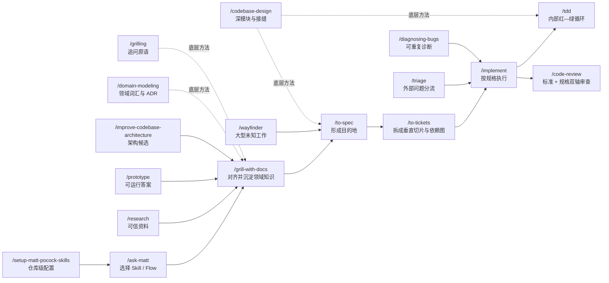

原网页：[AI Skills for Real Engineers — Skills Catalog](https://www.aihero.dev/skills-catalog)  
技能总览：[AI Hero Skills](https://www.aihero.dev/skills)  
开源仓库：[mattpocock/skills](https://github.com/mattpocock/skills)

整理日期：2026-07-16

> **一句话结论**  
> 这套目录真正提供的不是 21 段“万能提示词”，而是一套可组合的工程控制系统：先让人和 Agent 对齐，再把共识沉淀为规格与任务，用小步测试和独立审查约束实现，并持续维护领域语言、模块边界和代码库健康度。

## 执行摘要

网页把 Skill 定义为 Agent 可以反复执行的聚焦工作流：它明确说明需要什么输入、应按什么方式行动，以及最终应产生什么结果。作者的目标不是再包一层庞大的流程框架，而是把资深工程师面对某类问题时会采取的关键动作写下来，让 Agent 每次都尽量按同样的标准执行。

这套系统有四个鲜明特点：

1. **保留人的判断权。** `/grill-with-docs`、`/to-spec`、`/to-tickets` 分别处理对齐、目的地和执行路径，不让 Agent 把尚未确认的业务选择偷偷变成实现假设。
2. **重视可运行的反馈。** `/prototype` 用一次性程序回答设计问题，`/tdd` 用红—绿循环约束实现，`/diagnosing-bugs` 先建立可重复失败的反馈回路再推理。
3. **把长期语义放到会话外。** `CONTEXT.md`、ADR、规格、任务、研究报告和 handoff 文档共同构成外部记忆，新会话不必只靠聊天历史接力。
4. **治理代码结构，而不只追求产码速度。** `/codebase-design` 和 `/improve-codebase-architecture` 强调深模块、清晰接口和可测试接缝，目标是降低人和 Agent 必须同时理解的表面积。

网页公开目录共列出 **6 类、21 个 Skill**：

| 分类 | 作用 | Skills |
| --- | --- | --- |
| Getting Started | 完成仓库级配置，并在不确定时导航 | `/setup-matt-pocock-skills`、`/ask-matt` |
| The Main Flow | 从想法对齐一路走到实现与审查 | `/grill-with-docs`、`/to-spec`、`/to-tickets`、`/implement`、`/tdd`、`/code-review` |
| Shaping | 用调查、研究或原型消除关键不确定性 | `/wayfinder`、`/prototype`、`/research` |
| Upkeep | 维护架构、缺陷与问题队列的健康度 | `/improve-codebase-architecture`、`/diagnosing-bugs`、`/triage` |
| Non-Coding Skills | 面向人的通用工作流 | `/grill-me`、`/handoff`、`/teach`、`/writing-great-skills` |
| Reference Skills | 被其他 Skill 调用或引用的底层方法 | `/codebase-design`、`/domain-modeling`、`/grilling` |

## 一张图看懂整体关系



这张图表达的是主干与入口，而不是强制瀑布流程。小改动可以在充分对齐后直接进入 `/implement`；需要运行才能回答的问题可以先绕行 `/prototype`；超出单次会话容量的大型工作则先用 `/wayfinder` 建立决策地图，再回到 `/to-spec`。

## 两种调用方式

当前源码把 Skill 分成两个调用层：

| 类型 | 行为 | 典型 Skill |
| --- | --- | --- |
| 用户调用 | 只有用户明确输入 `/skill-name` 才启动，通常负责编排、写入外部系统或发起长流程 | `/setup-matt-pocock-skills`、`/ask-matt`、`/grill-with-docs`、`/to-spec`、`/to-tickets`、`/implement`、`/wayfinder`、`/triage`、`/grill-me`、`/handoff`、`/teach` |
| 模型调用 | 用户可以点名，Agent 也可以在任务匹配时自动采用，通常承载可复用的方法与纪律 | `/prototype`、`/research`、`/tdd`、`/code-review`、`/diagnosing-bugs`、`/codebase-design`、`/domain-modeling`、`/grilling` |

理解这一层很重要：网页按工作阶段分组，所以 `/tdd` 和 `/code-review` 被列在 Main Flow；但实际运行时，它们经常由 `/implement` 在内部带起，而不需要用户逐步手动调用。

## 安装与初始化

网页给出的全量全局安装方式是：

```bash
npx skills add mattpocock/skills -y -g
```

去掉 `-g` 即安装到当前项目。当前仓库 README 还提供交互式安装方式：

```bash
npx skills@latest add mattpocock/skills
```

只安装某个 Skill：

```bash
npx skills add mattpocock/skills --skill=<skill-name>
```

更新某个 Skill：

```bash
npx skills update <skill-name>
```

安装后应先在每个仓库运行一次 `/setup-matt-pocock-skills`。如果只记住一个入口，记住 `/ask-matt`：描述当前处境，它会告诉你该进入哪个 Skill 或哪条 Flow。

---

## 01 Getting Started：先配置，再导航

### 1. [`/setup-matt-pocock-skills`](https://www.aihero.dev/skills-setup-matt-pocock-skills)：为仓库建立共享配置

**定位。** 这是整个工程技能集的一次性 bootstrap。它不实现功能，而是让后续 Skill 知道三件事：任务保存在哪里、triage 使用哪些标签、领域文档采用什么布局。没有这些配置，`/triage`、`/to-spec`、`/to-tickets` 只能猜测 Issue Tracker、标签或 `CONTEXT.md` 的位置。

**何时使用。** 每个仓库首次使用这套工程 Skills 前运行一次。日常调整可以直接编辑它生成的配置；只有更换 Issue Tracker 或希望重新开始时，才需要重跑。

**核心流程。** 它先探索 `git remote`、现有 `AGENTS.md` / `CLAUDE.md`、`CONTEXT.md`、ADR、`docs/agents/`、本地 `.scratch/` 约定以及 monorepo 信号，再把发现和推荐方案交给用户确认。随后依次解决：

- **Issue Tracker：** GitHub、GitLab、本地 Markdown，或用户描述的 Jira、Linear 等自定义流程；
- **Triage 标签：** 默认映射 `needs-triage`、`needs-info`、`ready-for-agent`、`ready-for-human`、`wontfix`，仅在安装了 `/triage` 时配置；
- **领域文档：** 默认单上下文，即仓库根目录的 `CONTEXT.md` 与 `docs/adr/`；检测到真实 monorepo 信号时才讨论多上下文地图。

**主要产物。** `docs/agents/issue-tracker.md`、`docs/agents/domain.md`，以及按需生成的 `docs/agents/triage-labels.md`；同时在仓库已有的 `CLAUDE.md` 或 `AGENTS.md` 中增加或更新 `## Agent skills` 索引。它先展示草稿再写入，因此本质上是“探索—推荐—确认—记录”的提示驱动流程，不是无条件生成固定脚手架。

**边界与成功信号。** 它不应重复创建另一份 Agent 指令文件，也不应未经确认猜测 tracker。成功后，下游 Skill 会直接使用真实 tracker 与标签，不再反复询问或创建重复约定。

### 2. [`/ask-matt`](https://www.aihero.dev/skills-ask-matt)：全技能路由器

**定位。** `/ask-matt` 只回答“现在该用哪个 Skill、按什么顺序用”，自己不采访、不写规格、不修 Bug。它把记忆 20 多个 Skill 的认知负担从用户身上移走。

**何时使用。** 当你只有一个模糊想法、不确定 Bug 应该进入 `/triage` 还是 `/diagnosing-bugs`、或无法区分两个相似 Skill 时使用。如果已经知道要调用什么，就跳过路由器。

**它提供的不是单点推荐，而是路径。** 典型主线是：

```text
grill-with-docs → to-spec → to-tickets → implement → code-review
                                      └→ tdd 作为实现内部循环
```

它还识别多种入口：外部 Bug 与需求先进入 `/triage`；顽固缺陷进入 `/diagnosing-bugs`；大型、模糊且跨多个会话的工作进入 `/wayfinder`；代码库健康问题由 `/improve-codebase-architecture` 产生候选，再并入主线。

**关键价值。** `/ask-matt` 强调 Flow，而不是把 Skill 当作互不相干的工具箱。它也帮助维护上下文卫生：在同一阶段尽量保留连续思考，接近上下文上限时通过 `/handoff` 跨会话；大型实现则让每个独立 ticket 在新上下文中执行。

**边界。** 路由结果不是交付物，也不会替代目标 Skill。它是地图，不是交通工具。

---

## 02 The Main Flow：从共同理解到可审查实现

### 3. [`/grill-with-docs`](https://www.aihero.dev/skills-grill-with-docs)：一边追问，一边维护项目知识

**定位。** 这是有代码库场景下的需求澄清入口。它组合底层的 `/grilling` 与 `/domain-modeling`：前者沿设计决策树持续追问，后者把刚刚确认的领域术语与重要取舍及时写入项目文档。它与普通 brainstorming 的差别是，不只让当前对话更清楚，还为未来会话留下可复用的语言和决策依据。

**何时使用。** 新功能还只有大致方向、业务规则存在多种解释、团队使用同一个词却表达不同含义，或准备写规格但尚未真正对齐时使用。无代码库、也不需要留下项目文档的计划讨论，改用 `/grill-me`。

**核心流程。** Agent 每次只问一个问题，并提供推荐答案；可以从代码、文件或工具中查到的事实由 Agent 自行探索，真正需要价值判断的决策才交给用户。讨论会逐个解决依赖关系，直到双方明确确认“已经形成共同理解”。期间若术语被澄清，立即更新 `CONTEXT.md`；只有遇到难以逆转、缺少上下文会令人困惑、且确实存在权衡的决定，才建议写 ADR。

**主要产物。** 一组明确的业务与设计决策、更新后的领域词汇表，以及少量真正有长期价值的 ADR。它不直接生成规格或代码；下一步通常是 `/to-spec`，小而明确的工作也可以直接进入 `/implement`。

**成功信号与边界。** 成功不是“Agent 问了很多问题”，而是关键分支已经关闭、代码事实与口头描述中的矛盾已被暴露、未决事项可以明确列出。用户确认共同理解前，Skill 不应擅自开始实现。

### 4. [`/to-spec`](https://www.aihero.dev/skills-to-spec)：把已经形成的共识写成规格

**定位。** `/to-spec` 把当前对话与代码库理解合成为可发布到 Issue Tracker 的规格，也可以理解为 PRD。它的关键约束是 **不重新采访用户**：如果还需要大量追问，说明上一步对齐没有完成，应返回 `/grill-with-docs`。

**何时使用。** 需求、术语与主要取舍已经谈清楚，希望在编码前保存“为什么做、最终应有什么行为、哪些决定已经定了”时使用，尤其适合跨多个会话或需要多人接力的工作。

**核心流程。** 它先确认当前代码状态，使用项目 `CONTEXT.md` 中的领域语言并遵守相关 ADR；然后草拟测试接缝，优先现有接缝、尽量选择更高层且数量更少的公开接口，并与用户确认。最后按固定骨架形成：问题、方案、长而完整的用户故事、实现决策、测试决策、范围外事项和补充说明。

**主要产物。** 一份发布到已配置 Issue Tracker 的规格，并直接标记为 `ready-for-agent`。规格记录模块、接口、架构、数据结构或交互层面的决定，但默认不写具体文件路径和大段代码，以避免实现演进后迅速过时；原型中高度凝练、能精确表达状态机或类型形状的片段可以作为例外保留。

**成功信号与边界。** 好规格应使用项目自己的词汇，让用户故事可以独立验收，并清楚区分目标、已定决策和 out of scope。它描述“目的地”，不负责把旅程拆成执行顺序；后者属于 `/to-tickets`。

### 5. [`/to-tickets`](https://www.aihero.dev/skills-to-tickets)：把规格拆成可独立交付的垂直切片

**定位。** `/to-tickets` 把规格、计划或当前对话转成一组 tracer-bullet tickets，并显式声明 ticket 之间的阻塞边。它解决的不是“如何把文档切成若干段”，而是“如何设计一条能够尽早产生真实反馈、又适合多个新上下文执行的路径”。

**何时使用。** 一个规格需要跨多个会话、需要并行 Agent、或存在明显依赖与高风险集成点时使用。单会话能安全完成的小工作通常不需要这一步。

**拆分原则。** 每张 ticket 应贯穿所需的数据、后端、界面与测试层，交付一条狭窄但完整、可演示或可验证的行为，并能在一个 fresh context 中完成。若先调整结构能显著降低后续难度，可以先安排 prefactoring；每张 ticket 还要列出真正阻塞它的上游，形成可执行 DAG，而不是假装所有任务都线性串行。

**特殊情况。** 大范围机械变更无法保持每个垂直切片独立通过时，不应生硬套用 tracer bullet，而应使用 expand–contract：先兼容新旧形式，再按爆炸半径分批迁移，最后删除旧形式。必要时通过集成分支承接中间不绿的批次，并用最终集成验证 ticket 收口。

**核心流程与产物。** Agent 先展示编号、阻塞关系和每张 ticket 的端到端交付内容，让用户确认粒度、依赖、合并或拆分方式；批准后再发布。使用本地 tracker 时，每张 ticket 是 `.scratch/<feature>/issues/` 下的独立文件；使用真实 tracker 时，优先建立原生 blocking / sub-issue 关系。产物默认已经是 `ready-for-agent`，无需再经过 `/triage`。

**执行方式。** 后续只处理 frontier——所有 blocker 已完成的 ticket。每张 ticket 由 `/implement` 在新上下文中完成，避免把上一张任务的实现噪音带进下一张。

### 6. [`/implement`](https://www.aihero.dev/skills-implement)：严格执行已经确定的工作

**定位。** `/implement` 是主流程中的“手”，不是重新决定方向的“头”。它读取已经确认的规格或 tickets，在预先商定的测试接缝上驱动实现，并在结束前完成验证、审查与提交。

**何时使用。** 工作内容和验收边界已经写清、准备真正修改代码时使用。若仍在争论用户行为或架构方向，应回到 `/grill-with-docs` 或 `/to-spec`；若只想对一个具体行为做小规模 test-first 开发，也可以直接调用 `/tdd`。

**核心流程。** 能采用 TDD 时，在预先确认的接缝上调用 `/tdd`，逐个行为推进；实现过程中频繁运行类型检查与单个相关测试文件，结束时再运行完整测试套件。完成后调用 `/code-review` 审查相对固定起点的 diff，并把结果提交到当前分支。

**主要产物与成功信号。** 产物不仅是“代码能跑”，还包括与规格对应的测试证据、通过的类型与测试反馈、双轴 review 结果，以及当前分支上的 commit。它不应在实现过程中悄悄扩大范围或发明新接缝；发现规格缺口时，应把问题显式抬回用户或上游工件。

### 7. [`/tdd`](https://www.aihero.dev/skills-tdd)：用一个行为一个循环驱动实现

**定位。** `/tdd` 是 Main Flow 的内部反馈引擎，也可以单独用于功能或修复。它关心的不只是“先写测试”，更强调测试应该放在哪里、验证什么，以及怎样避免写出与实现互相证明的无效测试。

**好测试的标准。** 测试通过公开接口观察行为，读起来像可执行规格，内部实现即使完全重构也不应随之改动。测试位于预先确认的 **seam**；没有与用户确认测试接缝前，不应开始堆测试，因为测试资源应该集中在关键路径和复杂逻辑，而不是覆盖每个内部细节。

**核心循环。** 每次只处理一个垂直行为：先写一个会因预期原因失败的测试，看到红；再写刚好使它通过的最少实现，看到绿；根据这一轮得到的真实信息再进入下一轮。当前版本明确把结构性重构放到 review 阶段，不把未来需求或抽象提前塞进红—绿循环。

**重点反模式。** 一是测试私有方法、内部协作者或重构就会变化的实现细节；二是断言用与被测代码相同的算法重新计算期望值，形成 tautological test；三是先批量写完所有测试、再批量实现的水平切分，因为它锁定的是想象中的结构，而不是逐步发现的真实行为。

**成功信号。** 每个测试都能说明新增了哪项外部能力，红灯确实证明测试可以捕获缺失行为，绿灯由最小实现获得；实现结束后，测试仍然只依赖稳定公开接口。

### 8. [`/code-review`](https://www.aihero.dev/skills-code-review)：把“写得对”和“做得对”分开审查

**定位。** `/code-review` 从一个明确 fixed point 审查到 `HEAD` 的变更，同时运行两个互相隔离的审查轴：**Standards** 检查代码是否遵守仓库标准，**Spec** 检查实现是否忠实满足原始 Issue / PRD / 规格。两个维度并行运行，避免其中一个维度的印象污染另一个。

**何时使用。** 审查分支、PR、WIP 变更，或希望检查“从某个 commit / branch / tag 之后发生了什么”时使用。未提供 fixed point 时必须先确认；Skill 会用三点 diff 相对 merge-base 比较，并先验证引用有效且 diff 非空。

**Standards 轴。** 它读取 `CONTRIBUTING.md`、`CODING_STANDARDS.md` 等仓库约定，并附加一组 Fowler code-smell 基线，例如重复代码、Feature Envy、Data Clumps、Primitive Obsession、Shotgun Surgery、Speculative Generality 和 Middle Man。仓库明确约定优先；smell 永远是需要判断的提示，不应冒充硬性违规，也不重复报告已被工具自动保证的事项。

**Spec 轴。** 它优先从 commit message 的 Issue 引用、用户提供的路径、分支名对应的 specs / docs / `.scratch` 工件寻找原始目标，检查缺失或只完成一部分的要求、未经要求的 scope creep，以及看似完成但实现方向错误的行为。找不到规格时，应明确跳过这一轴，而不是凭空补一份需求。

**主要产物。** 两份并列报告，各自保留证据、位置与严重问题摘要。Skill 有意不把两个轴重新混排成一个总榜：代码可能完全符合风格却实现了错误需求，也可能功能正确却破坏项目约定，二者需要分别看见。

---

## 03 Shaping：用决策、原型和证据消除不确定性

### 9. [`/wayfinder`](https://www.aihero.dev/skills-wayfinder)：为超大、充满未知的工作建立决策地图

**定位。** `/wayfinder` 面向“大到单次 Agent 会话装不下，而且从现状到终点的路线仍看不清”的工作。它不是提前列出一份看似完整的实施计划，而是在 Issue Tracker 上建立共享地图，把当前能说清的问题变成 **decision tickets**，逐个消除决策阻塞，直到前往目的地的路径清晰。

**何时使用。** 绿地项目、超大功能、跨产品与技术域的迁移，或任何需要多次会话、多人和多个 Agent 才能完成的高认知工作。若一次梳理后已经没有“雾”，说明工作足够小，不应为了仪式感建地图。

**地图结构。** 一个带 `wayfinder:map` 标签的父 Issue 是唯一 canonical map，包含：

- **Destination：** 地图走完时应得到的规格、决定或状态；
- **Notes：** 领域、应调用的 Skills 与长期偏好；
- **Decisions so far：** 已关闭 ticket 的一行摘要与链接；
- **Not yet specified：** 已知将来要处理、但现在连问题都无法精确表述的 fog；
- **Out of scope：** 明确越过 Destination 的工作。

地图只做低分辨率索引，详细答案只存在对应 ticket 的 resolution comment 中，不在多处复制。面向人的叙述使用 ticket 名称与链接，而不是堆砌裸 Issue 编号。

**四类 ticket。** `research` 由后台 Agent 读取一手资料；`prototype` 通过粗糙可运行物提高讨论保真度；`grilling` 通过人机逐问逐答解决决策，是默认类型；`task` 完成某项必须先发生的前置动作。前两类分别调用 `/research` 与 `/prototype`，HITL ticket 不能由 Agent 自问自答。

**核心流程。** 建图时先用 `/grilling` 和 `/domain-modeling` 明确 Destination，再广度优先发现当前可表述的决策；先创建票、后连接原生 blocking 关系，并立即并行启动 research tickets。继续地图时，只读取低分辨率地图，选择 frontier 中开放、未阻塞、未被领取的 ticket，先通过 assignee 声明领取，再在一个会话中解决一个；随后评论答案、关闭 ticket、向地图加入上下文指针，并根据新知识创建新票、清理 fog 或关闭越界票。

**主要产物与边界。** 产物是一张动态决策地图、可见的 frontier、已经确认的范围边界和一条逐渐清晰的路线。默认只规划、不执行；当人开始想“直接把它做了”，往往说明已经走到地图边缘，应把结果交给 `/to-spec`，再进入 `/to-tickets` 和 `/implement`。

### 10. [`/prototype`](https://www.aihero.dev/skills-prototype)：用一次性程序回答一个设计问题

**定位。** `/prototype` 的目标不是得到能长期维护的代码，而是把一个难以在纸面上判断的问题变成可操作证据：状态模型是否符合直觉，或界面应该采用哪种结构。

**两个分支。** Logic 分支构建一个小型交互式终端程序，让用户推动状态机经过尴尬边界，并在每次动作后看到完整状态；UI 分支在同一路由提供多个结构上明显不同的界面方案，通常 3 个、最多 5 个，通过 URL 参数和浮动切换条对比，而不是只改颜色和文案。

**共同规则。** 原型代码放在未来使用位置附近但必须清楚标记；一条命令即可运行；默认仅使用内存状态；不写生产级测试、容错、持久化与通用抽象；每次动作或方案切换都展示完整相关状态。问题不明确且用户不在线时，可以依据周边代码选择 Logic 或 UI，但要把假设写在原型顶部。

**完成方式。** 确认答案后，将有效决定写回 Issue、ADR、规格或正式实现；完整原型则提交到不合并 main 的一次性分支，并从实施 Issue 留下上下文链接。主分支只保留经过验证的决定，不保留失败变体、TUI 外壳或试验切换器。

**成功信号与边界。** 成功是用户能明确回答最初问题，而不是原型越来越像产品。开始补测试、异常处理、扩展点和长期持久化，通常意味着已经越界。现有功能为何失败应交给 `/diagnosing-bugs`；事实与规范问题应交给 `/research`。

### 11. [`/research`](https://www.aihero.dev/skills-research)：把阅读体力活交给后台 Agent

**定位。** `/research` 针对一个具体事实性问题，启动后台 Agent 查阅高可信一手来源，并把结论写成可复核的 Markdown 文档。它的价值不仅是查到答案，还包括不阻塞主线程，以及让研究结果脱离对话成为后续可引用的证据。

**资料标准。** 优先官方文档、源码、正式规范和第一方 API；关键结论要追溯到真正拥有该事实的来源，而不是引用二手博客对官方材料的再转述。每项重要主张应就近标注来源，无法确认之处也应保留不确定性。

**主要产物。** 一份集中、结构化、有引用的 Markdown 文件，保存在仓库已有的研究笔记位置；没有约定时选择合理目录并明确告知。作为 `/wayfinder` 的 research ticket 执行时，结果还可以保存在一次性研究分支，并由 ticket 留下上下文指针。

**何时使用与边界。** 适合核对某版本 API、规范条款、库的真实实现或第三方行为；不适合代替用户做价值取舍，也不负责实现。需要从运行反馈判断未来设计时用 `/prototype`，需要澄清人的偏好时用 `/grilling`。研究结果通常回流 `/grill-with-docs` 或 `/to-spec`，为决策提供证据，而不是替代决策。

---

## 04 Upkeep：维护代码库与需求入口的健康度

### 12. [`/improve-codebase-architecture`](https://www.aihero.dev/skills-improve-codebase-architecture)：寻找值得加深的模块

**定位。** 这个 Skill 扫描真实架构摩擦，寻找把浅模块变成深模块的机会：以更小、更稳定的接口隐藏更多行为，提升 locality、leverage、可测试性与 Agent 可导航性。它不是把所有“看起来可以重构”的地方列成清单，而是优先寻找未来仍会产生回报的结构改进。

**扫描策略。** 用户指定模块、子系统或痛点时直接聚焦；否则先从较长一段 `git log` 找近期反复变化的热点，再决定扫描范围。探索前读取 `CONTEXT.md` 与相关 ADR，随后有机地记录：理解一个概念是否需要跨许多小模块、接口是否几乎与实现同样复杂、为单测抽出的纯函数是否丢失真实调用局部性、耦合是否泄漏，以及当前接口是否让系统行为难以测试。

**筛选原则。** 每个候选都接受 deletion test：删除模块后，复杂度是消失了，还是散回多个调用方？只有后者说明模块正在真正集中复杂度、具有加深价值。建议必须使用 `/codebase-design` 的 module、interface、depth、seam、adapter、leverage、locality 词汇，并用项目领域语言命名。

**第一阶段产物。** Skill 在操作系统临时目录生成一份自包含 HTML 报告，不污染仓库。每个候选包含涉及文件、摩擦、白话解决方向、对测试和局部性的收益、before/after 图，以及 `Strong`、`Worth exploring` 或 `Speculative` 推荐强度；报告最后明确给出 Top recommendation。此时只说加深方向，不提前设计接口。

**第二阶段。** 用户选中候选后才进入 `/grilling`，讨论约束、依赖、seam 内外和应保留的测试；新的领域词汇由 `/domain-modeling` 更新。若要比较不同接口，调用 `/codebase-design` 的 design-it-twice 模式。用户因长期有效的关键理由拒绝候选时，可以建议写 ADR，避免未来扫描反复提出同一建议。

**边界。** 它是调查和决策支持，不直接完成大型重构。已经明确目标模块、只缺接口设计时直接用 `/codebase-design`；理论上有趣但近期不会变化的区域不应因“架构洁癖”优先处理。

### 13. [`/diagnosing-bugs`](https://www.aihero.dev/skills-diagnosing-bugs)：先造出红灯，再讨论根因

**定位。** 这是针对顽固 Bug、偶发 flake 和性能回退的严格诊断循环。整套方法最重要的一步不是阅读代码，而是先建立一条能捕获用户原始症状的 **tight feedback loop**；没有可靠红灯，后面的假设、二分与插桩都只是在消费猜测。

**阶段一：建立反馈回路。** 可以从失败测试、curl、带 fixture 的 CLI、无头浏览器、trace replay、最小 harness、property/fuzz、`git bisect run`、新旧版本 differential loop，一直尝试到结构化 HITL 脚本。完成标准是一条已经实际运行过的命令：能经过真实 Bug 路径并断言精确症状、快速、确定或具有稳定高复现率，而且 Agent 可以自行执行。若做不到，必须说明已经尝试什么，并请求环境访问、HAR / 日志 / core dump 等捕获物，或临时生产插桩授权；不能直接进入理论阶段。

**阶段二至四：缩小假设空间。** 先多次确认是同一个故障，再逐项删除输入、调用者、数据与配置，直到最小复现中的每个元素都不可缺少。随后一次生成 3–5 个排序、可证伪的假设，并说明每个假设预测什么；向用户展示以利用领域知识校正排序。验证时一次只改变一个变量，优先 debugger / REPL，其次在能区分假设的边界加带唯一 `[DEBUG-...]` 前缀的定点日志；性能问题先测基线和 profiler / query plan，不先凭感觉优化。

**阶段五：修复与回归。** 在能够复制真实调用模式的正确 seam 上，把最小复现转为失败回归测试，看到红，再修复、看到绿，最后重跑第一阶段未最小化的原始场景。若没有合适 seam，不能用一个过浅测试制造虚假安全感；“架构无法锁住此 Bug”本身就是重要发现。

**阶段六：清理与复盘。** 确认原始复现和回归测试都转绿，清掉所有 debug 日志和一次性 harness，并在 commit / PR 中记录最终正确假设。若根因暴露出纠缠调用者、隐藏耦合或缺失测试 seam，修复完成后再交给 `/improve-codebase-architecture`。

**边界。** 简单且已有紧密反馈的错误可以说明理由后跳过部分阶段，但不能在没有 red-capable loop 时靠浏览代码宣称根因。未来设计是否合理属于 `/prototype`，不是调试。

### 14. [`/triage`](https://www.aihero.dev/skills-triage)：把原始请求推进到可信状态

**定位。** `/triage` 管理 Issue Tracker 中已经到达的 Bug、需求和按配置纳入的外部 PR。它用一个小型状态机完成分类、验证、补充信息和 Agent brief，使 `ready-for-agent` 真正意味着“AFK Agent 可以直接接手”，而不是“有人随手贴了一个标签”。

**角色模型。** 每个已 triage 事项恰好有一个类别：`bug` 或 `enhancement`；再恰好有一个状态：`needs-triage`、`needs-info`、`ready-for-agent`、`ready-for-human`、`wontfix`。实际标签字符串来自 `/setup-matt-pocock-skills` 的映射；发现冲突状态时先请维护者处理，不自行猜测。

**查看队列。** Skill 按最旧优先展示三类：未加标签、`needs-triage`、以及 reporter 在上次记录后有新回复的 `needs-info`。若配置把外部 PR 视为 request surface，则将 PR 当作“附有代码的 Issue”纳入相同状态机；自动发现只找符合 external 定义的 PR，显式点名的 PR 不受此限制。

**处理单项的流程。** 先读取正文、评论、标签和历史 triage notes，并探索代码库；用领域概念检查需求是否已经实现，同时搜索 `.out-of-scope/` 中的历史拒绝。然后向维护者推荐类别和状态并等待方向。访谈前先验证主张：Bug 尝试复现，PR checkout 后运行相关测试。信息不足时再组合 `/grilling` 与 `/domain-modeling`，一次解决一个问题。

**结果处理。** `ready-for-agent` 发布持久、可执行的 Agent brief；`ready-for-human` 使用类似结构但说明人工权限、判断或手测原因；`needs-info` 记录已经确认的事实和给 reporter 的具体问题；已实现请求直接指向现有代码，拒绝 enhancement 才写入 `.out-of-scope/`；`wontfix` 按原因说明后关闭。维护者也可以直接要求状态覆盖，Skill 确认即将发生的写操作后执行，不强行重新访谈。

**透明性与边界。** 所有由 triage 写入 Tracker 的内容必须以 AI 生成声明开头。它处理的是未经整理的外部输入，不处理 `/to-tickets` 已经生成的 agent-ready tickets；新对话写规格使用 `/to-spec`，顽固 Bug 的深度诊断使用 `/diagnosing-bugs`。

---

## 05 Non-Coding Skills：面向人的通用工作流

### 15. [`/grill-me`](https://www.aihero.dev/skills-grill-me)：不依赖代码库的高强度访谈入口

**定位。** `/grill-me` 是一个非常薄的用户入口：它只负责启动底层 `/grilling`。适合压力测试产品想法、个人计划、方案或任何非代码设计，让模糊意图沿决策树逐步变成明确取舍。

**使用方式。** 用户显式输入 `/grill-me`，Agent 不会自动启动。它一次只问一个问题，每题给出推荐答案，等待用户回应后再选择下一分支；能从环境中查到的事实由 Agent 自行查，价值判断和真实取舍由用户决定。双方确认共同理解前，不开始执行。

**主要产物。** 产物是会话中的共享理解：明确的目标、约束、选择和未决项。默认不创建代码、PRD、ADR 或词汇表，因此它比 `/grill-with-docs` 更轻、更通用，也更偏短期。

**边界。** 有代码库且希望把术语与决定长期保存时，优先 `/grill-with-docs`；只需要底层可复用访谈行为时，直接使用 `/grilling`。它的强度不来自问题数量，而来自按依赖顺序关闭关键分支。

### 16. [`/handoff`](https://www.aihero.dev/skills-handoff)：把长会话压缩成可恢复的接力点

**定位。** `/handoff` 为 fresh agent 或新会话生成一份交接文档。它不是总结整段聊天，而是保留仍然活跃的线程：当前在做什么、为什么这样做、已经走到哪里、下一步是什么。

**何时使用。** 接近上下文上限、准备收工、需要把工作转给另一个 Agent，或为了原型 / 研究分支主动打开新会话时使用。调用时可以附加“下一会话准备用来做什么”，文档会据此调整重点。

**压缩原则。** 已经存在于规格、计划、ADR、Issue、commit 或 diff 中的信息只引用路径或 URL，不复制正文；这样既避免重复，也减少新 Agent 面对相互冲突版本的风险。文档还包含 `suggested skills`，帮助接手者知道下一步该调用什么，并在写入前清理 API Key、密码与个人身份信息。

**主要产物与边界。** 单一 Markdown 交接文档保存在操作系统临时目录，不落入工作区形成新的长期维护负担。新 Agent 结合该文档和引用工件即可继续。Skill 本身不会替用户创建或切换会话，也不替代规格和知识库；它只是跨上下文的桥。

### 17. [`/teach`](https://www.aihero.dev/skills-teach)：把学习变成有状态的长期项目

**定位。** `/teach` 把当前目录变成一个跨会话教学工作区，围绕用户真正想达成的结果持续设计短课、练习和参考资料。它不是一次性解释，而是一套会记住学习状态、难度与偏好的课程系统。

**工作区结构。** `MISSION.md` 保存学习动机、成功标准与边界；`RESOURCES.md` 维护经过筛选的一手或高可信资料；`lessons/*.html` 是编号、短小、自包含的主要教学单元；`reference/*.html` 保存会反复查阅的速查表、算法、流程和 glossary；`learning-records/*.md` 只记录已经通过表现证明的学习；`assets/*` 复用样式、测验、模拟器和图表组件；`NOTES.md` 保存教学偏好。

**核心教学观。** 每一课都要服务于 Mission，并落在学习者的最近发展区：有挑战，但不超出当前能力太多。事实不能只依赖模型参数记忆，应先从可信资料建立 Knowledge；教学先降低无谓难度帮助理解，再通过检索练习、间隔与交错练习形成 Skills。目标是长期 **storage strength**，而不是当下看起来顺畅的 fluency。

**课程形式。** 每课只解决一个紧凑目标，快速完成并带来具体成果，使用清晰视觉与来源引用，附一个最值得继续阅读的一手资源。练习要有尽量即时、最好自动化的反馈。多课会复用统一 assets，使工作区像一个持续演进的课程，而不是散乱网页。

**学习证据与智慧。** “讲过”不等于“学会”，learning record 应来自测验、任务表现、纠正误解或 Mission 变化。需要真实情境判断时，Skill 会建议高质量社区、课程或实践环境；用户不愿参与时应尊重。

**边界。** 一个工作区最好只服务一个 Mission；临时问答不需要 `/teach`。它不会一次生成一门庞大课程，而是根据真实学习记录逐课调整。

### 18. [`/writing-great-skills`](https://www.aihero.dev/skills-writing-great-skills)：让随机系统执行可预测过程

**定位。** 这是编写、重构和诊断 Agent Skill 的元参考。它追求的 predictability 不是每次生成相同文字，而是同类任务每次都沿相同过程工作。

**调用设计。** Model-invoked Skill 可由 Agent 自动发现、也可被其他 Skill 调用，但 description 会持续占用 context load；User-invoked Skill 只有用户能启动，几乎不占模型上下文，却把“记住它”的 cognitive load 交给用户。手动 Skills 多到难记时，应像 `/ask-matt` 一样增加 router，而不是把全部 Skill 改成自动触发。

**描述与信息层级。** 自动调用的 description 要前置强 leading word，每个真正不同的触发分支只写一次，删除同义词堆叠。内容按即时程度排列：`SKILL.md` 内的有序步骤、同文件中的参考、通过 context pointer 延迟加载的外部参考。每个步骤应有可检查、必要时穷尽式的完成标准，以减少 premature completion。

**何时拆分。** 只有新能力拥有独立触发词、需要被其他 Skill 调用，或后续步骤持续诱导当前步骤草率结束时才拆；拆分不是免费操作，会增加 context load 或 cognitive load。仅特定分支需要的材料适合 progressive disclosure，所有分支都需要的规则应留在主文件，并将定义、规则和例外 co-locate。

**剪枝方法。** 每个含义只保留一个 single source of truth；逐句做 relevance 与 no-op test，不改变默认行为的句子直接删。用模型预训练中已有的 leading word——如 `relentless`、`red`、`tracer bullet`——压缩重复描述并稳定行为。

**重点失败模式。** Premature completion、Duplication、Sediment、Sprawl、No-op 和 Negation。其总体态度是：不要靠继续加规则修补所有问题，先让完成标准更清楚、层级更合理、单一事实来源更干净。

---

## 06 Reference Skills：被上层工作流复用的底层方法

### 19. [`/codebase-design`](https://www.aihero.dev/skills-codebase-design)：用统一语言设计深模块

**定位。** `/codebase-design` 不是自动重构命令，而是一套关于模块形状、接口和测试接缝的共享词汇。目标是设计 **deep module**：调用者只学习小而稳定的接口，却能获得大量行为；维护者则把变化、Bug、知识和验证集中在局部。

**核心词汇。** Module 是任何同时拥有 interface 与 implementation 的实体；Interface 不只包含类型签名，还包含调用者必须知道的不变量、顺序、错误、配置和性能；Depth 衡量单位接口学习成本能获得多少行为；Seam 是无需在该位置修改代码即可替换行为的地方；Adapter 是在 seam 上满足 interface 的具体角色；Leverage 是调用方获得的能力复用；Locality 是复杂度集中带来的维护收益。

**关键原则。** Depth 是接口的属性，不应简单用实现行数除以接口行数。Deletion test 判断模块是否值得存在：删除后复杂度散回多个调用者，说明它提供了深度；删除后复杂度直接消失，可能只是 Middle Man。Interface 也是测试表面，测试若必须越过接口窥探内部，模块形状可能有问题。一个 adapter 只代表假想变化点，至少两个真实 adapter 才值得建立公开 seam。

**面向可测试性的设计。** 依赖由调用方注入而不是模块内部偷偷创建；优先返回可观察结果，而不是只产生难验证副作用；减少方法数量和参数复杂度。内部可以存在私有 seam 和多个小部件，但不应因为测试方便就把它们全部暴露给调用者。

**Design It Twice。** 重要接口不必接受第一种可行答案。补充材料会让多个并行 Agent 从“极小接口”“更强灵活性”“常见调用者体验”等不同方向提出显著不同的设计，再按 depth、locality 与 seam placement 比较，并给出有立场的推荐或混合方案。

**边界。** 需要扫描全库候选时用 `/improve-codebase-architecture`；领域词语本身模糊时用 `/domain-modeling`。这个 Skill 设计形状与语言，但不会自动完成重构。

### 20. [`/domain-modeling`](https://www.aihero.dev/skills-domain-modeling)：主动维护项目的统一领域语言

**定位。** `/domain-modeling` 用于真正改变领域模型：确定规范术语、拆开重载词、压力测试概念关系、核对口头规则与代码，并记录少量高价值决定。只是读取 `CONTEXT.md` 沿用词汇，是所有 Skill 都应有的普通习惯，不算主动建模。

**核心流程。** 当用户的说法与 glossary 冲突时立即指出；遇到“account”“status”这类模糊或承担多种含义的词时，提出更精确的 canonical term；通过具体边缘场景逼出概念之间的真实边界；用户描述行为时检查代码，如果代码与口头模型不同，明确要求决定哪一个才是真相。

**文件纪律。** 术语一旦确认就立刻更新 `CONTEXT.md`，而不是会话末尾批量回忆。默认仓库根目录单上下文；存在 `CONTEXT-MAP.md` 时，写入对应子上下文。文件按需延迟创建。`CONTEXT.md` 只能是领域 glossary，不保存实现细节、规格、临时思路或通用编程词汇。

**ADR 门槛。** 仅当决定同时满足“难以逆转”“没有背景会令人意外”“来自真实备选方案的取舍”时才建议写 ADR。缺少任何一项都跳过，避免决策日志退化成开发日记。

**主要产物与边界。** 精确、可复用的领域词汇表，必要时加少量 ADR，以及代码与口头规则矛盾的明确结论。模块接口与 seam 问题交给 `/codebase-design`；完整计划的系统性追问交给 `/grilling`。

### 21. [`/grilling`](https://www.aihero.dev/skills-grilling)：所有“追问型”Skills 的访谈原语

**定位。** `/grilling` 是 `/grill-me` 和 `/grill-with-docs` 背后的单一访谈规则，也会被 `/wayfinder`、`/triage`、架构治理等流程复用。把规则抽成底层 Skill，可以避免每个上层入口各写一份、长期漂移。

**执行规则。** 把计划、想法或决定视为一棵有依赖关系的决策树，从上游依赖开始，一次只问一个问题；每题提供 Agent 的推荐答案，等待用户反馈后再继续。能由文件、代码与工具查到的是事实，应由 Agent 自行探索；涉及偏好、风险和取舍的是决定，必须交给用户确认。

**停止条件。** 用户明确确认已经形成共同理解后，访谈才结束，并且在此之前不采取行动。其产物默认只是对话中的决策树和共享理解，不自动写文档、Issue、规格或代码；需要这些副作用时，应使用相应 wrapper。

**边界。** 不一次提出一组问题，不把调查事实的劳动推给用户，也不以“我已经理解”为由替用户决定关键取舍。它是行为原语，不是完整交付流程。

---

## 场景速查：我现在该用哪个 Skill？

| 当前处境 | 优先 Skill | 它会把你带到哪里 |
| --- | --- | --- |
| 第一次在这个仓库使用整套 Skills | `/setup-matt-pocock-skills` | 配好 tracker、标签与领域文档布局 |
| 不知道该用哪个 Skill 或怎样组合 | `/ask-matt` | 推荐一条 Skill Flow |
| 有代码库，但想法、边界和词汇仍模糊 | `/grill-with-docs` | 共同理解、glossary、少量 ADR |
| 讨论已完成，想保存正式目的地 | `/to-spec` | 发布一份 agent-ready 规格 |
| 工作跨多个会话，需要切片与依赖 | `/to-tickets` | 形成可并行的 tracer-bullet tickets |
| 规格或 ticket 已明确，准备修改代码 | `/implement` | TDD、验证、review 与 commit |
| 只想把一个具体行为 test-first 做出来 | `/tdd` | 逐行为红—绿循环 |
| 想审查某个 fixed point 之后的变化 | `/code-review` | Standards 与 Spec 两份独立报告 |
| 项目巨大，连实施路线都还看不清 | `/wayfinder` | 决策地图、frontier 与清晰路线 |
| 只有运行或看到多个版本才能决定 | `/prototype` | 一次性可运行证据与明确结论 |
| 需要核对官方文档、规范或源码事实 | `/research` | 一份有一手来源引用的研究文档 |
| 代码越来越难理解、难测试或难修改 | `/improve-codebase-architecture` | 可视化 deepening 候选与首选方向 |
| Bug 顽固、偶发或属于性能回退 | `/diagnosing-bugs` | 紧反馈回路、最小复现、根因与回归测试 |
| 外部 Issue / PR 堆积，质量参差不齐 | `/triage` | 可信状态与可执行 brief |
| 没有代码库，只想压力测试一个计划 | `/grill-me` | 会话中的共同理解 |
| 要跨会话或转交另一个 Agent | `/handoff` | 临时接力文档与建议 Skills |
| 想把学习做成持续多次会话的项目 | `/teach` | Mission、课程、练习与学习记录 |
| 想创建、改进或瘦身一个 Skill | `/writing-great-skills` | 更可预测的调用与执行设计 |
| 模块接口太宽、测试接缝不合理 | `/codebase-design` | 深模块、接口与 seam 设计语言 |
| 领域词汇冲突、模糊或代码与口头模型不一致 | `/domain-modeling` | 精确 glossary 与必要 ADR |
| 需要在其他流程中复用逐题访谈 | `/grilling` | 无文档副作用的访谈原语 |

## 建议的落地顺序

> 以下是基于目录结构提炼的团队采用建议，不是官网规定的强制流程。

### 第一阶段：先跑通最小闭环

选择一个低风险、能在几天内完成的真实需求：

```text
setup → grill-with-docs → implement（内部 tdd）→ code-review
```

目标不是一次引入全部 21 个 Skill，而是先验证三件事：团队是否能在编码前形成共同理解，测试是否位于稳定接缝，review 是否能独立发现“标准问题”和“规格问题”。

### 第二阶段：让跨会话工作可恢复

当工作开始超出一个上下文窗口，再引入：

```text
to-spec → to-tickets → 每张 ticket 一个 fresh context → handoff 按需接力
```

此时应重点检查 ticket 是否真的是端到端切片、阻塞边是否真实，以及新 Agent 是否只读规格、ticket 与仓库工件就能继续。

### 第三阶段：增加不确定性消除与长期治理

- 关键事实不清楚时用 `/research`，纸面无法决定时用 `/prototype`；
- 大型未知项目才使用 `/wayfinder`，不要把它下放给普通小功能；
- 周期性运行 `/triage` 和 `/improve-codebase-architecture`；
- 顽固缺陷统一采用 `/diagnosing-bugs` 的反馈回路纪律；
- 把 `/domain-modeling` 与 `/codebase-design` 作为团队共享语言，而不只是 Agent 私有提示词。

## 最容易误读的九件事

1. **分类顺序不等于每步都要手动调用。** `/tdd` 和 `/code-review` 常由 `/implement` 内部带起。
2. **不是每个变更都需要 spec 和 tickets。** 小而明确的单会话工作可以直接实现；流程长度应与风险和上下文跨度匹配。
3. **`/to-spec` 不负责重新澄清需求。** 它如果还在大规模提问，说明上游对齐没有完成。
4. **`/triage` 不处理 `/to-tickets` 生成的票。** 后者已经是 agent-ready；triage 面向未经整理的外部输入。
5. **原型不是“以后再重构”的生产代码。** 它从第一天就应可丢弃，留下的是答案和证据，不是半成品系统。
6. **TDD 不是先批量写完测试。** 当前版本坚持一个行为一次红—绿循环，并把结构性重构交给 review 阶段。
7. **深模块不等于大文件。** Depth 来自小接口提供高 leverage；内部可以由很多私有小部件组成。
8. **`CONTEXT.md` 不是万能文档。** 它只保存领域 glossary，规格、实现和临时笔记各有自己的位置。
9. **`/wayfinder` 的票主要解决决策，而不是交付功能。** 路线清楚后应回到 `/to-spec`，不要把地图无限扩张成实施项目管理器。

## 这套 Skill System 最值得借鉴的设计思想

### 1. 把流程拆开，防止目标、计划和实现一起漂移

`grilling` 解决共同理解，`to-spec` 保存目的地，`to-tickets` 设计旅程，`implement` 执行，`code-review` 独立检查。每个阶段都有不同的输入、完成标准和失败方式，比分配给 Agent 一段超长“从需求到上线全包”的提示更容易定位问题。

### 2. 把 Agent 的速度绑定到反馈速度

Prototype、TDD、diagnosis loop、typecheck 和 review 都在缩短“做出动作—看到证据—修正方向”的距离。Agent 可以快速产出代码，但系统实际速度仍受最慢的可信反馈约束。

### 3. 把关键状态外部化，但控制文档腐烂

这套系统并不是鼓励无止境写文档。`CONTEXT.md` 只做 glossary，ADR 设置很高门槛，handoff 只放临时目录，规格不写易过期的文件路径，研究结论要有引用。每种信息有清晰归宿，才能让外部记忆比聊天历史更可靠。

### 4. 让共享词汇本身成为控制面

Domain terminology、tracer bullet、fog of war、frontier、seam、adapter、depth、red-capable loop 都是 leading words。它们不仅节省说明文字，还让人、Agent、规格、tickets 和代码使用同一套可复用概念。

### 5. 保留明确的人类关口

用户确认业务取舍、测试接缝、ticket 粒度、地图 Destination 和架构候选；维护者确认 triage 状态；HITL 原型和 grilling 不能由 Agent 自己扮演用户。自动化负责系统性探索与执行，人仍负责价值判断和风险责任。

## 结语

AI Hero 的 21 个 Skills 最有价值的地方，不是某个 Skill 的措辞，而是它把软件工程中的隐性判断拆成了可重复、可组合、可检查的工作流。它承认 Agent 会误解、会遗忘、会过早行动，也承认高速编码会更快制造复杂度；因此整套系统围绕对齐、外部记忆、反馈回路、模块边界和独立审查建立护栏。

对于团队而言，成熟的 AI Coding 不应只用“Agent 写了多少代码”衡量。更好的问题是：换一个 fresh Agent 后，它能否依靠清晰的领域语言、规格、任务依赖、测试接缝与 review 证据，在有限上下文中继续做对事情。

## 资料来源与范围说明

- 主目录：[AI Skills for Real Engineers — Skills Catalog](https://www.aihero.dev/skills-catalog)
- 当前技能总览：[AI Hero Skills](https://www.aihero.dev/skills)
- 官方源码与设计说明：[mattpocock/skills](https://github.com/mattpocock/skills)
- 本文按网页公开目录在 2026-07-16 可见的 **6 类、21 个 Skill** 整理，并结合各 Skill 的官网详情页与当前 `SKILL.md` 补足执行细节。
- 官方仓库仍在持续演化。当前 README 还列出了网页 21 项目录之外的 `/resolving-merge-conflicts`；因为用户给定网页尚未把它纳入这六类目录，本文不展开介绍。
- 本文是面向中文读者的解释性总结，不是逐句翻译；“落地顺序”等段落是基于官方工作流的归纳建议，已与官方事实性描述区分。
