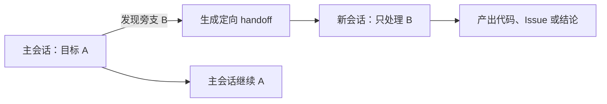
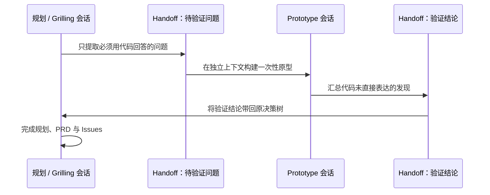

> Matt Pocock《/handoff is my new favourite skill》详细解读

> 真正稀缺的不是更大的上下文窗口，而是把正确的上下文送到正确的下一位 Agent

原视频：[YouTube / dtAJ2dOd3ko](https://www.youtube.com/watch?v=dtAJ2dOd3ko)

讲者：Matt Pocock  |  发布日期：2026-05-21  |  时长：12 分 24 秒（YouTube 元数据为 744 秒）

整理日期：2026-08-22

> **一句话结论**<br>
> `/handoff` 会围绕“下一会话要完成什么”提炼当前对话，把仍在进行的工作压缩成一份临时 Markdown 交接单，从而让另一会话、另一 Agent 甚至另一种 Coding Harness 接手；它最有价值的场景不是普通续聊，而是把旁支任务隔离出去，以及在“规划 → 原型 → 规划”之间往返传递经过验证的结论。

## 执行摘要

Matt Pocock 做 `/handoff` 的起点非常朴素：他经常在长会话里遇到一个值得处理、但不属于当前目标的旁支任务。直接做会污染当前上下文，忽略又可能丢失机会，使用 `/compact` 则只能继续同一条会话主线。于是，他反复让 Agent 把与旁支有关的上下文写成 `handoff.md`，交给另一个新会话；重复次数多到足以将这个习惯封装为 Skill。[00:00](https://www.youtube.com/watch?v=dtAJ2dOd3ko&t=0s) [04:49](https://www.youtube.com/watch?v=dtAJ2dOd3ko&t=289s)

视频先用“smart zone / dumb zone”解释为什么要管理上下文。会话越长，工具输出、文件内容、讨论和修改历史越多，模型需要在更大的信息面中寻找当前真正重要的约束。Pocock 说，他个人大约在 120K token 左右开始感觉回答质量下降；这是一条个人经验警戒线，不是 Anthropic 给出的硬阈值，也不意味着所有模型、任务和会话都在同一点退化。[01:36](https://www.youtube.com/watch?v=dtAJ2dOd3ko&t=96s)

`/compact` 和 `/handoff` 都会做有损压缩，但解决的问题不同。`/compact` 把旧对话总结后继续当前工作，适合调试等需要沿同一问题持续推进的长会话；`/handoff` 则把与某个明确目标有关的上下文写成可携带文件，让另一条工作线独立开始，原会话保持原目标和决策脉络不变。[03:22](https://www.youtube.com/watch?v=dtAJ2dOd3ko&t=202s) [04:49](https://www.youtube.com/watch?v=dtAJ2dOd3ko&t=289s)

视频展示了两种实际用法：

1. 在 grilling / 规划对话中，把突然出现的独立 API 重构想法移交给另一 Agent，当前问题随之收窄；
2. 把只有运行代码才能回答的问题交给原型会话，原型完成后再生成反向 handoff，只把未被代码直接表达的结论带回规划会话。

第二种模式尤其重要。它让探索性工作使用自己的上下文预算，并让主会话保留产品和设计决策连续性。Pocock 把它称作一种“DIY sub-agent”：主会话派出一个有明确任务的工作单元，工作单元完成后用另一份交接文档回传结果。[06:14](https://www.youtube.com/watch?v=dtAJ2dOd3ko&t=374s) [07:20](https://www.youtube.com/watch?v=dtAJ2dOd3ko&t=440s)

Skill 本身很短，但包含五条关键约束：写明下一会话焦点；建议下一位 Agent 使用哪些 Skills；已有 spec、issue、commit、diff 等工件只引用、不复制；文件放在操作系统临时目录；写入前脱敏 API Key、密码和个人身份信息。[09:50](https://www.youtube.com/watch?v=dtAJ2dOd3ko&t=590s)

## 一张表看懂核心区别

| 维度 | `/compact` | `/handoff` |
| --- | --- | --- |
| 核心问题 | 如何让当前工作在更小的上下文中继续 | 如何让工作移动或分叉到另一上下文 |
| 工作拓扑 | 一条主线继续向前 | 新建独立工作线，可与原会话并行 |
| 原会话 | 被压缩后的摘要继续参与后续推理 | 可以原样保留，继续当前目标 |
| 输出形态 | Harness 内部的压缩上下文 | 一份可读取、可传递的 Markdown 文件 |
| 内容选择 | 面向当前会话的整体延续 | 围绕下一会话目标做定向切片 |
| 典型场景 | 长时间调试、同一任务继续推进 | 旁支任务、原型、跨工具交接、交给同事 |
| 共同代价 | 都把原始对话变成摘要，细节可能丢失 | 都把原始对话变成摘要，细节可能丢失 |

> **关键判断**<br>
> 视频表面在讲“压缩”，真正新增的能力却是**分叉和可携带性**：`/compact` 延长一条会话，`/handoff` 改变工作的流向。

## 1. 一个“小到不像 Skill”的重复动作

Pocock 一直在尝试把自己的编码直觉和工作习惯封装成可复用 Skills。`/handoff` 起初只是一个他觉得“太简单，不值得单独做成 Skill”的动作：

1. 读取当前会话；
2. 总结出另一位 Agent 继续工作所需的上下文；
3. 写成 Markdown；
4. 让新会话读取它并继续。

他先手工重复这个流程，后来发现使用频率很高，于是在视频发布前几周将其加入 `mattpocock/skills` 的 productivity 目录。[00:00](https://www.youtube.com/watch?v=dtAJ2dOd3ko&t=0s)

视频发布前两天的 [Skill 源码](https://github.com/mattpocock/skills/blob/d54c497aa94400a496d3f2c38be10fa5f284c5a9/skills/productivity/handoff/SKILL.md) 只有很短的正文。它的目的不是生成一份漂亮的会议纪要，而是让 fresh agent 能继续一项仍在进行的工作。

这个例子体现了 Pocock 对 Skill 的一个重要判断：**是否值得封装，不取决于提示词有多长，而取决于它是否把一个高频判断变成稳定行为。**

## 2. 为什么“大上下文”仍然需要预算

### 2.1 上下文窗口不等于可靠工作容量

在编码会话中，下列内容都会持续消耗上下文：

- 人与 Agent 的对话；
- Agent 的工具调用及其结果；
- 读取过的源码、日志和文档；
- 已尝试但失败的方案；
- 补丁、测试结果和中间推理状态。

Pocock 用两个非正式概念描述体感差异：[01:36](https://www.youtube.com/watch?v=dtAJ2dOd3ko&t=96s)

- **Smart zone：** 上下文相对干净，Agent 更容易聚焦当前任务；
- **Dumb zone：** 内容大量堆积后，注意力变得分散，回答更容易遗漏约束或偏离目标。

视频称 Claude Code 可使用 1M-token 上下文，并说自己大约在 120K token 时就开始感到进入 dumb zone。他没有把会话推到 800K，因为在那之前已经会主动管理上下文。[01:59](https://www.youtube.com/watch?v=dtAJ2dOd3ko&t=119s) [02:44](https://www.youtube.com/watch?v=dtAJ2dOd3ko&t=164s)

### 2.2 必须保留的证据边界

这部分最容易被误传为“120K 以后模型必然变笨”，但原视频说的是 **personally**：这是 Pocock 的个人使用感受。更准确的理解是：

- 支持的模型、套餐和配置可以提供很大的标称上下文窗口，但并非每个 Claude Code 会话都无条件拥有 1M token；
- 长上下文中的检索、聚焦和推理质量可能退化，但不存在适用于所有模型和任务的统一 120K 分界线；
- 内容结构、相关信息的位置、工具输出噪声、任务类型和模型版本都会影响有效上下文；
- “token 更多，因此 attention 关系更多、注意力更稀释”是视频中的直觉解释，不应当作完整的因果证明。

Anthropic 的[上下文工程文章](https://www.anthropic.com/engineering/effective-context-engineering-for-ai-agents)讨论了 context rot 和保持上下文相关性的必要性，但没有给出通用的 120K 硬阈值。

**我的归纳：** 团队不必争论某个神奇数字。更实用的做法是监控行为信号：Agent 开始重复读文件、忘记刚确认的约束、把已排除方案重新提出、修改范围漂移，或需要越来越多提示才能回到目标时，就应考虑清理、压缩、拆分或移交。

## 3. `/compact` 解决的是“同一条线如何继续”

视频把 compaction 描述为把已经很大的对话总结成一个较小的信息块，再从较干净的上下文继续。某些 Harness 还会在接近上下文上限时自动 compact。[03:22](https://www.youtube.com/watch?v=dtAJ2dOd3ko&t=202s)

Pocock 用“沉积层”比喻反复 compact：后续会话一直引用上一层摘要，再产生下一层摘要，历史状态逐层沉积。它可能不够高效，却很适合必须沿同一问题持续尝试的工作。例如调试时，可以把已经试过的路线压缩保存，再继续测试其他假设。[04:03](https://www.youtube.com/watch?v=dtAJ2dOd3ko&t=243s)

这里需要避免两个误读：

1. `/compact` 压缩的是对话上下文，不等于删除工作区代码、commit 或外部工件；
2. “摘要中通常包含文件列表、用户说过的话和对话语气”是讲者对当时工具行为的观察，不是所有 Harness 永久不变的格式契约。

因此，`/compact` 的合理定位是：**当前目标不变，当前操作者不变，只是给这条工作线回收上下文预算。**

## 4. `/handoff` 解决的是“另一条线如何开始”

Pocock 遇到的真实矛盾是：当前会话正在做 A，却发现一个未来要做的 B。[04:49](https://www.youtube.com/watch?v=dtAJ2dOd3ko&t=289s)

如果直接在当前会话做 B：

- A 与 B 的代码、讨论和约束会混在一起；
- 上下文目标被稀释；
- 更快接近性能退化区；
- A 可能因此无法完成。

如果把整个会话 compact 后转去做 B：

- 原本围绕 A 建立的对话连续性被摘要替代；
- A 的主线程不再保持原样；
- B 得到的仍可能是大量与自身无关的背景。

他真正想要的是：**只提取与 B 有关的上下文，让新会话独立做 B，同时让原会话继续做 A。**



这不是单纯的会话恢复，而是上下文路由：同一段历史中只有与下一任务有关的切片会被带走。

## 5. 演示一：把规划中的旁支移出主线

视频的第一个案例来自 Pocock 为 Sandcastle 规划未来功能的一次 grilling 会话。当讨论进行到第 2 个问题时，他想到未来可能要把 iterations 和 completion signal 移到独立 API。[06:14](https://www.youtube.com/watch?v=dtAJ2dOd3ko&t=374s)

他没有在当前规划里展开设计，而是明确告诉 Agent：

- 现在要把这件事 hand off；
- 新会话的目标是研究该 API 拆分；
- 产物应包括一个 GitHub Issue；
- 原讨论继续留在当前范围。

这个动作产生了两个结果：

1. **新任务获得了可执行入口。** 交接文件保存了创建 Issue 所需的上下文；
2. **原问题反而更清楚。** Agent 识别到该方向已移出范围，于是当前问题的一部分“折叠”掉，不再继续消耗规划会话。

随后，他在另一 Agent 中读取 handoff 并创建 Issue。这个案例说明，handoff 不只是会话末尾的续接工具，也可以在会话中途作为**范围控制机制**。

**我的归纳：** 每当讨论中出现“这个也应该顺手做掉”时，都可以问一句：它是当前目标的必要组成，还是一个应当独立验收的旁支？如果是后者，handoff 比不断扩张当前任务更健康。

## 6. 演示二：规划 → 原型 → 规划的往返闭环

第二个案例是视频最值得复用的模式。Pocock 认为 grilling 中会遇到两类未知：[07:20](https://www.youtube.com/watch?v=dtAJ2dOd3ko&t=440s)

- **Known unknowns：** Agent 可以通过提问，让人做出业务或产品选择；
- **必须运行后才知道的问题：** 仅靠讨论无法可靠回答，需要 UI 原型、SDK 集成或复杂逻辑实验。

他的规划会话进行到第 13 个问题时，剩余不确定性涉及 window communication 和 tldraw SDK 集成。继续口头推演的收益有限，于是他生成一份面向 prototype 的 handoff，在独立分支和新会话中实现原型。该原型会话最终达到约 169K token，远大于他希望塞进原 planning 会话的内容。[07:55](https://www.youtube.com/watch?v=dtAJ2dOd3ko&t=475s)

原型完成后，他又要求该会话生成一份反向 handoff：

- 不复制原型代码已经直接表达的内容；
- 提取原型带来的关键认识；
- 特别记录不明显、无法仅从代码中快速看出的结论；
- 把结果交还最初的 planner。

完整过程如下：



Pocock 把它称为 DIY sub-agent 模式：每个会话获得专门任务和独立上下文预算，父会话只接收压缩后的结果。[08:35](https://www.youtube.com/watch?v=dtAJ2dOd3ko&t=515s)

这套结构的工程价值是：

- 规划上下文不被大量实现细节淹没；
- 原型 Agent 可以自由试错，不必保持最终代码质量；
- 回传的是经过运行验证的知识，而不是另一轮猜测；
- 主会话保留了用户回答和设计决策的连续性；
- 原型代码本身与“从原型学到了什么”各有唯一载体。

## 7. Markdown 为什么是一个重要选择

视频强调，handoff 只是普通 Markdown，因此不依赖某一种 Agent 的原生会话机制。[09:23](https://www.youtube.com/watch?v=dtAJ2dOd3ko&t=563s)

例如：

- 主会话可以运行在 Claude Code；
- 接手者可以是 Codex 或 Copilot CLI；
- 也可以把文件交给同事，而不是另一个自动化 Agent；
- 不同模型可以基于同一交接单进行对抗式审查。

这里的优势是**信息格式可携带**，不代表执行环境完全可移植。另一工具可能没有相同的 Skill、MCP、权限、工作区路径或依赖。因此，交接文档仍需要说明环境前提，并尽量引用接手者可以访问的路径和 URL。

## 8. Skill 中五条约束，各自解决什么问题

视频最后逐条解释了 `/handoff` 的设计。[09:50](https://www.youtube.com/watch?v=dtAJ2dOd3ko&t=590s)

### 8.1 写出 `suggested skills`

Pocock 用 Skill 定义下一会话的工作方式或“口味”。因此 handoff 会建议接手 Agent 调用适合任务的 Skill，例如 grilling、diagnosis 或 prototype。[09:52](https://www.youtube.com/watch?v=dtAJ2dOd3ko&t=592s)

这相当于不只传递“做什么”，还传递“应该采用哪种受控流程”。不过，目标 Harness 若未安装同名 Skill，就必须把建议转换成它能执行的工作方法。

### 8.2 已有工件只引用，不复制

早期 handoff 容易不断膨胀，把其他 Markdown、PRD、Issue、commit 和 diff 全部复制进来。Skill 明确要求使用路径或 URL 指针。[10:30](https://www.youtube.com/watch?v=dtAJ2dOd3ko&t=630s)

这样做有三点收益：

- 缩短交接单；
- 避免同一事实出现两个会漂移的副本；
- 让正式工件继续充当唯一事实源。

### 8.3 保存到操作系统临时目录

Handoff 是运输中的临时信息，不是长期项目文档。把它放进仓库，容易形成没人维护、很快过期的“文档化会话残骸”。因此 Skill 要求写到 OS temp directory，而不是当前 workspace。[10:44](https://www.youtube.com/watch?v=dtAJ2dOd3ko&t=644s)

这也意味着它不应承担永久记录职责。需要长期保存的业务词义、架构原因或验收契约，应提升到 `CONTEXT.md`、ADR、spec、Issue、测试或代码中。

### 8.4 写入前脱敏

Skill 明确要求清除 API Key、密码和个人身份信息（PII）。[10:58](https://www.youtube.com/watch?v=dtAJ2dOd3ko&t=658s)

但“Agent 已执行脱敏”不等于安全保证。若文件要跨机器、跨团队或上传到外部系统，人仍应检查内容；临时目录也不天然等于加密、安全或立即删除。

### 8.5 用参数说明下一会话的目的

Pocock 认为这是写好 handoff 的必要条件。没有目的，Agent 只能泛化地总结整场聊天；有了目的，它才能判断哪些事实、决定和未决项真正相关。[11:12](https://www.youtube.com/watch?v=dtAJ2dOd3ko&t=672s)

比较下面两种调用意图：

```text
/handoff
```

```text
/handoff 给独立原型会话：验证 WebView 与宿主窗口的通信方式；
只需回答接口可行性、失败模式和推荐方案，不实现生产功能。
```

后者定义了接手者、目标、范围和预期答案，生成的交接单会显著更聚焦。

## 9. 一份高质量 handoff 应该包含什么

> 以下模板是根据视频中的约束整理出的团队实践建议，不是视频展示的固定输出格式。

```markdown
# Handoff：<下一会话的单一目标>

## 接手任务
- 要回答或交付什么：
- 明确不做什么：
- 完成信号：

## 当前背景
- 为什么出现这项工作：
- 它与主任务是什么关系：
- 只列下一会话必须知道的约束：

## 已确认事实
- [已验证] ...
- [已验证] ...

## 当前判断与不确定项
- [假设，待验证] ...
- [尚未决定] ...

## 已有工件（只引用）
- Spec：<path-or-url>
- Issue：<url>
- 相关代码：<path>
- Commit / Diff：<reference>

## 建议工作方式 / Skills
- prototype：回答一个可运行验证的问题
- diagnosing-bugs：先建立稳定复现

## 下一步
1. ...
2. ...

## 回传要求
- 哪些结果应带回主会话：
- 哪些内容已经由代码或正式工件表达，不要重复：
```

### 质量检查

一份 handoff 可以用下面六个问题验收：

- 接手者不打开原会话，能否说清唯一目标？
- 是否把“已验证事实”“当前判断”“未决问题”分开？
- 是否说明不做什么，防止任务再次膨胀？
- 已有 spec、Issue、commit 和 diff 是否使用引用而非复制？
- 接手者能否访问所有路径、仓库、分支和工具？
- 是否人工检查了密钥、令牌、个人信息和内部敏感数据？

## 10. 什么时候用 handoff，什么时候不用

视频主要比较 `/compact` 与 `/handoff`。截至本文整理日，Pocock 的[当前官方说明](https://www.aihero.dev/skills-handoff)进一步收紧了判断：handoff 的首要收益是 **portability，而不是 compression**；如果工作没有“移动”，通常不需要生成文件。

| 当前情况 | 更合适的动作 | 理由 |
| --- | --- | --- |
| 当前目标清楚、上下文仍干净 | 继续当前会话 | 不做不必要的有损摘要 |
| 同一 Harness、同一目录、同一任务，只需回收上下文 | `/compact` | 保留当前意图并继续主线 |
| 旧上下文完全不再需要 | `/clear` / 新会话 | 从空白开始最干净 |
| 同一环境支持原生子 Agent，短期并行任务可直接委派 | 原生 sub-agent / fork | 可以继承环境，少一道文件传递 |
| 跨 Harness、跨目录、交给同事，或把旁支独立出去 | `/handoff` | 需要一个可携带的定向工作包 |
| 需要长期保留项目规则 | `CLAUDE.md` / `AGENTS.md` 等 | 它是长期站立上下文，不是一次性在途信息 |
| 需要长期保留“为什么这样设计” | ADR / spec / Issue | 应进入受维护的正式工件 |

这个“优先 portability”的表述比视频更窄，是**视频发布后的官方用法演化**。它没有改变 Skill 的实现原则，而是更明确地防止用户把 handoff 当成更好的 `/compact`。

## 11. 团队落地时最值得建立的三个模式

> 以下为整理者基于视频的落地建议。

### 11.1 旁支隔离：保护当前任务边界

当会话中发现重构、Bug 或新需求时：

1. 判断它是否阻塞当前目标；
2. 若不阻塞，为它生成定向 handoff；
3. 在任务系统留下可追踪入口；
4. 原会话继续原目标，不顺手扩张范围。

这能减少“既然看见了就一起改”的隐性 scope creep。

### 11.2 证据往返：用原型回答设计问题

只对一个具体问题做原型，例如：

- 浏览器安全模型是否允许目标通信方式？
- 某 SDK 能否满足关键交互？
- 两种数据结构在真实规模下差异如何？
- UI 的三种候选布局哪一种真正可用？

原型完成后，回传“结论、证据、限制和仍未知项”，不要把整个实验会话重新灌回规划上下文。

### 11.3 异构复核：让不同 Agent 检查同一判断

利用 Markdown 的工具中立性，把同一问题交给另一模型做独立评审。为了避免“共享同一个错误前提”，handoff 应把事实来源指向原始代码或规范，并把未经验证的判断显式标为假设。

## 12. 风险与局限

### 12.1 摘要必然有损

原始对话是第一手过程，handoff 是二手压缩。遗漏的否决理由、语气差异或边缘约束可能改变下一位 Agent 的判断。重要决定应进入正式工件，而不是只依赖 handoff。

### 12.2 错误会被压缩成“事实”

如果原会话只是猜测“功能 X 尚未实现”，交接单却写成“X 不存在”，下一位 Agent 很可能把它当作前提而不再验证。应显式使用 `[已验证]`、`[推测]`、`[待确认]` 等标签。

### 12.3 临时目录并不耐久

临时文件可能被系统或 Harness 清理，重启后也可能消失。视频强调临时性是为了避免仓库文档腐烂；若交接不会立即发生，应该在受控位置短期保存，并在完成后清理。

### 12.4 引用可能不可达

交接单很小，是因为它引用外部工件；但接手者若没有仓库权限、分支、挂载目录或内部链接访问权，这些指针就会失效。跨环境前需要检查可达性。

### 12.5 跨 Harness 不等于能力一致

Claude Code、Codex 和 Copilot CLI 都能读取 Markdown，不代表它们拥有相同工具、Skills、权限和执行语义。`suggested skills` 应同时写出预期行为，让没有同名 Skill 的接手者也能理解。

### 12.6 Handoff 不能代替正式协作系统

它适合传递在途上下文，不适合替代 Issue 的所有权与状态、spec 的验收契约、ADR 的长期原因记录，或 commit/diff 的可审查变更。

## 13. 不要误读这段视频

**不是上下文超过 120K 就一定不可用。** 那是 Pocock 的个人体感警戒线，不是统一基准。

**不是 `/handoff` 比 `/compact` 更高级。** 两者处理不同拓扑；同一任务继续推进时，compact 往往更直接。

**不是把整段聊天改写成另一篇长文。** 好的 handoff 围绕下一任务选择信息，并引用已有工件。

**不是越频繁切会话越好。** 每次压缩都会丢信息，也会增加传递和校验成本。上下文仍相关且质量良好时，继续工作最省损耗。

**不是把临时 Markdown 提交进仓库。** 视频特意要求写到 OS 临时目录，目的就是防止它变成腐烂的长期文档。

**不是安全边界。** 自动脱敏是防线之一，不是把敏感 handoff 任意外发的授权。

## 14. 视频发布后的源码演化

视频发布于 2026-05-21。与视频最接近的是两天前的 [`d54c497`](https://github.com/mattpocock/skills/commit/d54c497aa94400a496d3f2c38be10fa5f284c5a9)，其文本与视频逐条讲解基本一致。

截至整理日，[当前 `SKILL.md`](https://github.com/mattpocock/skills/blob/main/skills/productivity/handoff/SKILL.md) 的核心行为没有变化，但有几处值得注意：

- 增加 `disable-model-invocation: true`，表示由用户明确调用，而非模型自行决定触发；
- 已有工件示例从 `PRDs` 泛化为 `specs`；
- `suggested skills` 更明确地要求下一位 Agent 调用 Skill 工具；
- 当前官方文档把适用面进一步收敛为“工作需要移动时使用”。

阅读视频时，应区分：

- **视频中的原始论证：** 通过 handoff 拆出旁支、保护主会话，并支持 prototype 往返；
- **当前官方定位：** 普通阶段切换更常用 compact；handoff 的独特价值是可携带性。

## 15. 给团队的最小试点方案

选择一个正在进行、但存在明确技术未知项的需求，进行一次小规模试点：

1. 在主规划会话中明确需求目标和不确定项；
2. 选出一个“必须运行代码才能回答”的问题；
3. 生成只面向该问题的 handoff；
4. 让另一会话构建一次性原型；
5. 生成反向 handoff，只记录证据、结论、限制和剩余未知；
6. 回到主会话完成设计，不把原型直接当生产实现；
7. 检查 handoff 是否比原始对话小很多，接手者是否无需重新询问背景；
8. 完成后删除临时交接单，把需要长期存在的知识提升到正式工件。

建议观察四个指标：

- 接手者开始有效工作的时间；
- 需要向原操作者补问背景的次数；
- 交接后因错误前提导致的返工；
- 临时交接内容最终有多少需要提升为 spec、Issue、ADR 或测试。

## 结语

这段视频最值得带走的，不是一个六行左右的提示词，而是一种对 AI 工作的组织方式：**上下文不是越多越好，它应该有边界、有目的，也应该能够被路由。**

`/compact` 让一条工作线活得更久；`/handoff` 让另一条工作线在正确的背景下独立开始。把两者区分开后，规划会话不必吞下所有实验，原型会话不必携带全部产品讨论，旁支任务也不必污染当前目标。

好的 handoff 不是对过去的全面复述，而是一份面向下一动作的调度单：它说明要做什么、为什么、边界在哪里、证据去哪里找、哪些仍只是猜测，以及完成后要把什么带回来。

## 附录 A：官方章节与回看地图

| 时间 | 官方章节 | 核心内容 |
| --- | --- | --- |
| [00:00](https://www.youtube.com/watch?v=dtAJ2dOd3ko&t=0s) | Discovering the handoff skill | 从高频手工习惯到 Skill；将当前会话压缩为临时 Markdown。 |
| [01:36](https://www.youtube.com/watch?v=dtAJ2dOd3ko&t=96s) | Context windows and compact explained | 上下文增长、smart/dumb zone、120K 个人经验线，以及 compact 的工作方式。 |
| [04:49](https://www.youtube.com/watch?v=dtAJ2dOd3ko&t=289s) | Why handoff differs from compact | Compact 延续一条主线；handoff 为旁支切出独立会话。 |
| [06:14](https://www.youtube.com/watch?v=dtAJ2dOd3ko&t=374s) | Using handoff during grilling sessions | 把独立 API 想法移出规划范围，并交给另一 Agent 创建 Issue。 |
| [07:20](https://www.youtube.com/watch?v=dtAJ2dOd3ko&t=440s) | Handing off to prototype | 规划 → 原型 → 规划的双向交接；169K-token 原型会话。 |
| [09:23](https://www.youtube.com/watch?v=dtAJ2dOd3ko&t=563s) | Cross-agent workflow benefits | Markdown 可跨 Claude Code、Codex、Copilot CLI，也可用于对抗式评审。 |
| [09:50](https://www.youtube.com/watch?v=dtAJ2dOd3ko&t=590s) | Skill design decisions | 建议 Skills、只做引用、使用临时目录、脱敏、按下一会话目的定制。 |
| [11:44](https://www.youtube.com/watch?v=dtAJ2dOd3ko&t=704s) | Wrap up and course info | 总结、课程与后续内容预告。 |

## 附录 B：资料来源与证据边界

1. **一手来源：** [YouTube 原视频](https://www.youtube.com/watch?v=dtAJ2dOd3ko)。标题、频道、发布日期、744 秒时长、简介和 8 个官方章节均由 YouTube 页面数据核验。
2. **一手来源：** [视频发布时的 `/handoff` Skill](https://github.com/mattpocock/skills/blob/d54c497aa94400a496d3f2c38be10fa5f284c5a9/skills/productivity/handoff/SKILL.md)。该版本提交于 2026-05-19，用于核对视频中逐条解释的 Skill 文本。
3. **一手来源：** [当前 `/handoff` Skill](https://github.com/mattpocock/skills/blob/main/skills/productivity/handoff/SKILL.md) 与 [当前官方说明](https://www.aihero.dev/skills-handoff)。只用于“发布后的演化”与落地注意事项，不倒推为视频当时原话。
4. **一手来源：** Anthropic 的 [Effective context engineering for AI agents](https://www.anthropic.com/engineering/effective-context-engineering-for-ai-agents)、[Context windows](https://docs.anthropic.com/en/docs/build-with-claude/context-windows) 与 [Compaction](https://platform.claude.com/docs/en/build-with-claude/compaction) 文档。用于校准长上下文退化和 compaction 的证据边界。
5. **辅助转录：** [SozAI 完整转录页](https://sozai.app/transcript/handoff-new-favourite-skill/)。仅用于读取逐段自动字幕，并与 YouTube 官方章节、简介及固定 commit 源码交叉校对；其页面把转录日期写成视频上传日期，因此元数据不采用该站结果。

*口径说明：正文中“Pocock 认为 / 视频表示”是讲者主张；“我的归纳 / 团队建议”是基于视频和当前官方资料的推导。`120K`、反复 compact 的“沉积层”以及注意力变稀释均为讲者的经验模型，不是厂商承诺或通用科学阈值。*
