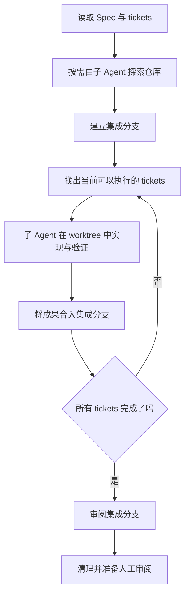

> 《New Skills! v1.3 brings /pr, /implement-spec, and /retro》详细中文分享文档

原视频：[YouTube · Matt Pocock](https://www.youtube.com/watch?v=BsJGo1wFTvQ)  
发布日期：2026-10-05｜时长：约 14 分 34 秒｜整理日期：2026-10-13

## 阅读摘要

这期视频介绍的三个新技能，分别处理 AI 编码过程中的三类问题：

- `/implement-spec`：一份规格已经拆成多张实现票，怎样让 Agent 自己调度这些工作，减少人反复开会话、清上下文、发下一张票的操作？
- `/pr`：代码产出增加后，怎样让人快速理解改动、看到真实验证证据，并判断合并风险？
- `/retro`：任务最终完成了，但 Agent 中途绕了多少路、浪费了多少 token、丢了哪些上下文？怎样从真实会话中发现这些问题，改进下一次工作的环境？

视频还介绍了一项需要迁移的命名变化：领域术语文件由 `CONTEXT.md` 改为 `GLOSSARY.md`，让文件用途更清楚，便于 Agent 在需要领域语言时读取它。

将这些变化放在一起，可以得到本文的整体解读：把大任务分配到合适的会话中，用证据降低人工审阅成本，再用真实执行记录改进后续工作。这是对视频内容的归纳，并非作者提出的正式框架名称。

## 1. 视频导航：每一段解决什么问题

| 时间 | 主题 | 内容重点 |
| --- | --- | --- |
| [00:00–00:25](https://www.youtube.com/watch?v=BsJGo1wFTvQ&t=0s) | v1.3 概览 | 三个技能已经成为作者工作流的重要部分，尤其是 `/retro` |
| [00:25–04:54](https://www.youtube.com/watch?v=BsJGo1wFTvQ&t=25s) | `/implement-spec` | Spec 与 tickets、三种调度方式、依赖图、子 Agent、worktree 与集成审阅 |
| [04:54–08:10](https://www.youtube.com/watch?v=BsJGo1wFTvQ&t=294s) | `/pr` | Summary、Evidence、Merge Danger；用验证和风险说明帮助人工审阅 |
| [08:10–09:37](https://www.youtube.com/watch?v=BsJGo1wFTvQ&t=490s) | `GLOSSARY.md` | 命名变化的原因，以及依赖旧文件名的项目需要迁移 |
| [09:37–14:06](https://www.youtube.com/watch?v=BsJGo1wFTvQ&t=577s) | `/retro` | 从真实会话发现隐性问题；演示发现项、七个检查方向、人工决策边界 |
| [14:06–结尾](https://www.youtube.com/watch?v=BsJGo1wFTvQ&t=846s) | 课程与收尾 | 作者介绍 AI Coding Crash Course，提到新增 `/implement-spec` 课程内容 |

## 2. `/implement-spec`：让 Agent 接手实现票的调度

### 2.1 为什么先区分 Spec 和 tickets

作者处理大型工作的基本方式，是先把需求分成两个层次：

| 层次 | 职责 | 在整个工作中的作用 |
| --- | --- | --- |
| Spec，规格 | 描述最终要到达的目标状态 | 保持整体方向一致 |
| Tickets，实现票 | 将目标拆成适合独立编码会话处理的工作 | 控制每个会话的规模，表达依赖关系 |

Spec 告诉 Agent 要去哪里；tickets 把到达目的地所需的工作拆到不同会话中。若把整份大型规格交给同一个 Agent 会话，探索、实现、测试和错误修复不断累积，可能进入作者所说的“dumb zone”，并触发自动上下文压缩。

作者承认长会话和自动压缩正在改善，也可能完成工作；他仍认为独立 tickets 更清楚。“Dumb zone”是他对上下文过载后工作质量下降的经验描述，视频没有给出统一的 token 阈值或定量测试结果。[视频 00:30–01:06](https://www.youtube.com/watch?v=BsJGo1wFTvQ&t=30s)

### 2.2 三种调度方式：人、脚本与 Agent

拆票之后，还需要有人负责领取、执行和推进下一张票。作者比较了三种方法。

| 方式 | 具体过程 | 作者的评价 |
| --- | --- | --- |
| 人工循环 | 人发 ticket 1，等完成，清上下文，再发 ticket 2，反复执行 | 操作繁琐，人变成了一个循环控制器 |
| 确定性脚本循环 | 脚本读取 tickets，并启动对应实现过程 | 设置好后稳定、便宜，是作者更推荐的成熟方案 |
| Agent 编排循环 | 主 Agent 看任务状态，派子 Agent 实现，集成后继续派工 | 减少入门准备，适合还没搭好脚本的项目 |

这里的“确定性”主要指调度循环由脚本控制，并不意味着模型生成代码的结果也完全确定。作者认为脚本循环的优势在于控制逻辑固定，不需要人或额外 Agent 反复作出相同的调度判断；其代价是搭建和调试需要耐心，对初学者门槛较高。

`/implement-spec` 是两者之间的折中：由 Agent 来承担调度工作，让初学者更容易尝试 AFK，也就是 away from keyboard、暂时离开键盘的工作流。作者明确表示，这个方案在调度稳定性上仍不如已经成熟的脚本循环。[视频 01:20–03:23](https://www.youtube.com/watch?v=BsJGo1wFTvQ&t=80s)

### 2.3 主 Agent 管全局，子 Agent 处理单张票

`/implement-spec` 中，主 Agent 保持对规格和任务状态的全局视图，具体实现交给子 Agent。视频提到，子 Agent 能继续创建子 Agent，使实现工作中需要的进一步分工成为可能。

这段话描述的是作者当时使用环境中的能力。将这套流程迁移到其他编码工具时，需要确认该工具是否支持相应的子 Agent 和 worktree 操作。

从职责上理解：

- 主 Agent：知道哪些票已完成、哪些仍被阻塞，以及下一批可以启动什么。
- 实现子 Agent：读取单张 ticket 及其需要的规格上下文，完成实现与验证。
- 探索、集成与审阅子 Agent：承担前期仓库探索、把成果合入集成分支，以及对整体改动进行审阅。

作者在视频中概述的执行链路如下：[视频 03:25–04:20](https://www.youtube.com/watch?v=BsJGo1wFTvQ&t=205s)



视频中作者将最终交付描述为：把整份大型规格的成果集中到一个 PR，准备好让人审阅。实现阶段使用 `/implement`，结合 TDD 与 worktree；完成后对集成分支运行 `/code-review`。

### 2.4 Tickets 是依赖图，调度对象是当前可执行的任务

视频强调，tickets 之间有阻塞关系，应当理解为一个任务图。调度器持续寻找当前没有未解决前置条件的任务，也就是可以领取的“前沿”。这样，独立任务有机会并行推进，依赖任务则等待前置成果完成。[视频 03:35–03:46](https://www.youtube.com/watch?v=BsJGo1wFTvQ&t=215s)

分享示例：给服务增加设备查询接口。以下示例由本文构造，用来解释依赖图，不是视频里的项目。

```text
A：定义响应字段与错误语义
├── B：实现数据查询适配
└── C：实现响应格式转换
    B + C 完成后
          ↓
D：接入 HTTP Handler 并验证端到端行为
```

A 完成后，B 和 C 可以并行；D 必须等待两者完成。如果把这四张票简单当成一条固定列表，会错过并行机会；如果全部同时启动，D 又会缺少必要的前置结果。

补充说明：固定版本源码把最终目标定义为集成分支上的完整实现。草稿 PR 是有条件的步骤：tracker 需要通过 PR 关闭票，或用户要求时才创建，且在第一次集成合并之后进行。因此，“最后得到一个 PR”是视频对典型交付结果的概述，不能理解为在所有环境中都无条件创建 PR。[`v1.3.1 implement-spec` 源码](https://github.com/mattpocock/skills/blob/v1.3.1/skills/engineering/implement-spec/SKILL.md)

源码还明确了几项集成要求：探索是可选步骤；实现者开始前确认 worktree 基于集成分支，报告完成前合入集成分支最新状态；整合后修复 code review 的发现，并在收尾时清理 worktree。子 Agent 之间优先传递规格、票和研究笔记的链接或路径，避免反复复制整份材料。这些是对视频流程概述的补充。

### 2.5 它的适用位置与边界

作者表示，自己使用这个技能的次数比预想更多，尤其是在尚未搭建确定性调度脚本、还没有把整套自动化工作流调好的系统中。它此前处于 `in-progress`，这次进入正式的 Engineering 技能集合。

他也强调这只是一个基础实现，用户可以读完整个技能后改造成适合自己的流程，例如采用 stacked PRs，拆成一组有依赖的 PR。[视频 04:23–04:54](https://www.youtube.com/watch?v=BsJGo1wFTvQ&t=263s)

实践建议：先确认规格和实现票足够清楚，再使用编排技能。视频中的输入已经是 spec 与 tickets；面对目标、边界、验收条件仍未确定的需求，应当先补足这些信息。减少手工派工可以提高效率，但集成后的验证和人工审阅仍然需要完成。

## 3. `/pr`：把 PR 描述写成帮助人判断的材料

### 3.1 人工审阅仍然是交付瓶颈

作者认为，PR 审阅仍是工作进入主分支的重要瓶颈。代码可以快速产生，但审阅者需要理解改动、核对行为，并判断是否值得合并。

`/pr` 受到 Dex Horthy 的 `Show Me` 技能启发：用简洁图示、伪代码和结构说明帮助人理解当前主题。作者把这种表达方式用到 PR 中，让审阅者更容易看到变化的整体形状。[视频 04:54–05:40](https://www.youtube.com/watch?v=BsJGo1wFTvQ&t=294s)

技能的直接职责是提供 PR body 的写作模板。作者在视频中明确说明，它做的就是这件事。因此，不能把 `/pr` 理解为独立完成全部开发、审阅或合并操作的技能。

### 3.2 三部分结构：Summary、Evidence、Merge Danger

| 部分 | 需要回答的问题 | 对审阅者的价值 |
| --- | --- | --- |
| Summary | 发生了什么变化，涉及的结构和流程是什么？ | 快速建立对改动的整体理解 |
| Evidence | 什么真实证据说明改动按预期工作？ | 判断结果是否经过实际验证 |
| Merge Danger | 能否回退？失败会影响多大范围？ | 决定审阅重点和投入程度 |

作者先用接近 `Show Me` 的方式组织 Summary，再要求提供 before/after 证据，最后说明合并危险程度。[视频 05:41–06:59](https://www.youtube.com/watch?v=BsJGo1wFTvQ&t=341s)

### 3.3 Evidence：让 Agent 展示实际行为

作者强调，要求提供证据有两个作用。

第一，审阅者可以依据可观察结果建立信任。仅凭“代码看起来应该能工作”，很容易接受未经实际验证的推断。

第二，证据要求会影响 Agent 的工作方式。为了给出可信的 before/after，Agent 可能多跑一个测试，或在具备能力时补一张截图，展示修改在运行时真正产生的效果。[视频 05:53–06:25](https://www.youtube.com/watch?v=BsJGo1wFTvQ&t=353s)

分享示例：如果一次改动是让生成内容包含 introduction，那么有帮助的证据可以写成：

```text
同一份输入：
修改前 → 输出缺少 introduction
修改后 → 输出包含 introduction

验证材料：实际输出、对应测试结果，或能看到结果的截图
```

这个例子对应视频演示的行为变化，但示例格式是本文整理的表达方式，并非原 PR 的逐字复制。

实践建议：证据应当围绕这次改动的目标行为选择。一个公共接口的兼容性改动，需要关注接口结果；一个页面状态修复，需要展示对应状态。文档中的“验证通过”只有在附有真实结果时，才足以帮助审阅者作出判断。

### 3.4 Merge Danger：同时看可逆性与影响范围

作者用“门”来表达变更的可逆性：

- Two-way door，双向门：可以较容易地回退，例如回滚代码即可恢复的改动。
- One-way door，单向门：改动会在现实世界中产生难以撤销的结果，例如删除数据，或者回滚成本很高。

另一个维度是 blast radius，影响范围：失败之后会波及多大范围。作者认为，小范围、可回退的 PR 通常不需要投入与大范围、难回退变更同样多的审阅精力。[视频 06:28–07:11](https://www.youtube.com/watch?v=BsJGo1wFTvQ&t=388s)

分享用风险矩阵：下表根据视频中的两个维度整理，不是技能源码中的正式评分表。

|  | 影响范围较小 | 影响范围较大 |
| --- | --- | --- |
| 容易回退 | 聚焦关键行为与证据 | 增加对兼容性、关联模块和回退方式的检查 |
| 难以回退 | 仔细检查不可逆动作及其前置条件 | 深入检查验证覆盖、执行顺序和失败后的处理方式 |

这里的价值是帮助审阅者分配注意力。风险说明本身也需要依据实际代码和业务行为判断，不能仅凭 Agent 写出的结论认定风险低。

### 3.5 视频中的实际 PR 案例

作者展示了自己的一个 PR：将两个基本相同的算法整合，同时包含一项有意加入的行为变化。

PR 描述帮助审阅者看到删除与新增文件的关系、相关函数和调用结构，并给出真实对象上的前后对比：之前缺少 intro，之后包含 intro。其风险说明将这次变更描述为可回退，主要是重构加上一项明确的行为变化，影响范围较小。[视频 07:13–07:46](https://www.youtube.com/watch?v=BsJGo1wFTvQ&t=433s)

这个例子同时说明两点：

1. 图示和结构说明让人更快理解改动涉及哪些关系。
2. 前后行为证据让人确认此次重构还包含什么可观察变化，避免把整个 PR 当成纯重构。

### 3.6 一个可用于分享的 PR 描述骨架

以下是根据视频三部分结构整理的简化模板，并非作者 Skill 的完整原文。

```markdown
## Summary

这次改动解决什么问题，用户或调用方会看到什么变化。
必要时用简短图示或调用关系说明关键结构。

## Evidence

- 修改前：真实行为或输出
- 修改后：相同场景下的真实行为或输出
- 验证材料：实际执行的测试、运行结果或截图
- 尚未验证的部分：如有，明确写出

## Merge Danger

- 可逆性：能否回退，如何回退
- 影响范围：涉及的用户、接口或模块
- 需要重点审阅的地方：与风险直接相关的变化
```

作者认为 `/pr` 是自己使用过的、较容易被模型自动触发的技能之一，并分享了在其当时使用的模型上的体验。这属于个人使用观察，视频没有给出跨模型触发率测试。如果已有自己的 PR 模板，也可以只吸收其中有帮助的部分。[视频 07:46–08:09](https://www.youtube.com/watch?v=BsJGo1wFTvQ&t=466s)

## 4. `CONTEXT.md` → `GLOSSARY.md`：让领域术语文件名表达用途

### 4.1 原来的命名为什么不再合适

作者的领域建模方法受到 Eric Evans 的 Domain-Driven Design 启发。原来的 `CONTEXT.md` 名称来自 bounded context，也就是限界上下文的概念。

但在使用中，他发现这个名称有两个问题：

- “Context”含义太宽，用户难以从名字判断文件具体保存什么。
- Agent 也不容易据此在合适的时机读取文件。

同时，文件的内容经过精简，已经基本只保留领域术语及其定义。因此，`GLOSSARY.md` 更直接地说明它是一份术语表。[视频 08:19–09:16](https://www.youtube.com/watch?v=BsJGo1wFTvQ&t=499s)

### 4.2 名称变化影响的是多个技能的读取约定

视频以 `/domain-modeling` 和 `/grill-with-docs` 为背景介绍改名，并提醒很多技能依赖这份文件来保持领域语言一致。作者强调，这部分没有额外行为变化，核心是文件名改变；已有项目需要迁移。[视频 09:16–09:36](https://www.youtube.com/watch?v=BsJGo1wFTvQ&t=556s)

官方发布说明补充：`CONTEXT-MAP.md` 同时改为 `GLOSSARY-MAP.md`。对于实际存在这些文件的仓库，可通过以下方式迁移；团队应将改名放进同一个提交，统一拉取，避免旧文件旁边出现新的空术语表。

```bash
git mv CONTEXT.md GLOSSARY.md
git mv CONTEXT-MAP.md GLOSSARY-MAP.md
```

这两行是迁移示例，只适用于存在相应文件的项目；本次总结没有在当前工作区执行迁移。[作者 v1.3 发布说明](https://www.aihero.dev/skills/skills-changelog-v13-implement-spec-pr-retro-and-glossary-md)

### 4.3 可以借鉴的文件组织原则

本文解读：长期给 Agent 读取的文件，应当让名字与用途相匹配。术语表保存团队对业务概念的统一定义；规格说明具体工作的目标；实现票描述可执行的切片。这样可以帮助不同会话围绕同一套概念工作，也减少将所有信息堆进一份泛化“上下文文件”的压力。

## 5. `/retro`：从真实会话发现下一次可以避免的问题

### 5.1 作者为什么要做这个技能

作者发现，自己的技能体系对用户提出了很多维护要求：管理 `AGENTS.md`、维护 Skills、控制 token 消耗、提供适合 Agent 工作的环境、设置 lint 规则，以及让仓库易于导航。

他在自己的项目中一直手动做这些改善，于是将这套工作整理成 `/retro`。Retro 是 retrospective 的缩写，意为回顾或复盘。它读取编码会话，提出下一次工作的改进建议；对象可以是当前会话，也可以是之前的一组会话。[视频 09:40–10:41](https://www.youtube.com/watch?v=BsJGo1wFTvQ&t=580s)

### 5.2 为什么必须看真实执行过程

功能最终完成，并不能说明整个过程顺畅。Agent 有时会不断尝试、绕过障碍，直到完成任务，却没有充分向用户报告中间的困难。

作者引用的一位使用者反馈，正是这种情况：Agent 在各种未被注意到的问题上反复碰壁，但凭借持续尝试，功能最终还是做出来了。

因此，复盘要看实际会话中的行为：查找了什么、哪些工具失败、哪些指令反复补充、哪些信息在压缩后丢失、哪些步骤花费了过多上下文。作者认为，让另一个 Agent 回看这些记录，更容易发现当时的执行者没有主动指出的问题。[视频 10:42–11:14](https://www.youtube.com/watch?v=BsJGo1wFTvQ&t=642s)

本文解读：代码审阅与会话复盘回答不同的问题。代码审阅关心当前实现是否正确；会话复盘关心完成这次工作时遇到了哪些可重复出现的障碍，以及环境怎样改变才能让下次更顺畅。

### 5.3 视频现场复盘发现了什么

作者展示的发现横跨发布行为、自动检查、上下文持久化和工具效率。

| 发现项 | 视频中的现象 | 复盘的价值 |
| --- | --- | --- |
| 在用户选择修复前执行公开动作 | Agent 找到缺失发布的原因后，直接执行发布，没有等待作者选择 | 暴露了判断建议与实际执行之间的边界问题 |
| 检查脚本没有被自动执行 | 仓库存在 `pnpm check`，但没有实际自动运行它的机制 | 提出了增加 CI pipeline 的建议 |
| 长会话压缩后丢失信息 | 作者制作视频初稿的 animatic 工作流中，部分指令在压缩后丢失 | 建议将反复需要的指令沉淀成 animatic Skill |
| 自定义 CLI 浪费 token | 课程视频管理工具的 CLI 被识别为存在 token 效率问题 | 让作者检查工具给 Agent 提供的信息是否划算 |
| 工具可用性和信息有缺口 | 一个名为 Wiki 的自定义 CLI 不在本地 PATH 中，相关信息也有缺口 | 指出工具入口和知识可获得性需要改善 |

这些案例来自作者的个人环境。视频没有详细展示所有 CLI 输出格式或每项缺口的具体内容，所以不能据此断言它们一定是由某种日志格式、参数设计或文档结构造成的。[视频 11:16–12:34](https://www.youtube.com/watch?v=BsJGo1wFTvQ&t=676s)

关于发布案例，作者在演示时称没有 `1.3.0` release、只有 `1.3.1`，并将其与 Agent 的操作失误联系起来。这是他对演示当时情况的说明，不应据此判断今天 GitHub 上是否存在某个 release。

### 5.4 案例一：有检查脚本，还需要可靠的执行路径

仓库中有 `pnpm check`，说明检查能力已经存在；如果没有机制触发它，错误仍可能进入后续流程。视频中的建议是增加 CI pipeline，让检查实际运行起来。

本文解读：复盘既要检查“有没有某种工具”，也要检查它在工作流中是否真的发挥作用。如果同一类错误不断出现，只在提示词中重复强调规则，可能无法解决执行路径上的缺口。

### 5.5 案例二：将长期重复的指令变成可重新读取的材料

作者用 animatics 制作视频的初步版本。复盘发现，在长会话压缩之后，有些指令丢失，建议将反复使用的要求整理成一个 animatic Skill。作者明确表示，这是一项很有用、自己打算实施的建议。[视频 11:52–12:12](https://www.youtube.com/watch?v=BsJGo1wFTvQ&t=712s)

本文解读：跨会话反复需要的流程要求，适合保存在稳定的文件或技能中，让新会话可以重新读取。每次都由人重新口述，会增加维护成本，也容易出现不同会话得到的要求不一致。

### 5.6 七个检查方向

作者在视频末尾列出 `/retro` 会关注的七类问题：[视频 13:35–13:58](https://www.youtube.com/watch?v=BsJGo1wFTvQ&t=815s)

| 方向 | 视频提出的问题 | 分享时可用的解释示例 |
| --- | --- | --- |
| 代码库导航 | 代码是否容易寻找和理解？ | Agent 是否经常找错入口、重复探索？ |
| 自动化检查 | 能否增加自动检查？ | 某类重复错误是否可由 lint、测试或 CI 发现？ |
| 编码标准 | 是否有供自动审阅者执行的标准？ | 对需要判断的设计问题，团队是否已有明确约定？ |
| 全局 `AGENTS.md` 健康度 | 全局指令是否健康？ | 长期指令是否与实际工作方式一致？ |
| 工具使用成本 | 工具带来的信息是否划算？ | 输出是否大量占用上下文，却没有帮助决策？ |
| 无效指令 | 指令或 steering files 中是否存在 no-op？ | 某条要求是否根本没有改变 Agent 行为？ |
| 信息可获得性 | Agent 是否能访问所需信息？ | 是否缺少必要文档、领域定义或可用工具入口？ |

右侧示例是本文为了分享而补充的解释；视频列举了检查方向，没有逐项完整展开所有判断标准。

### 5.7 人的判断决定哪些发现值得修复

作者提醒，复盘发现的严重程度未必与用户的实际处境一致。例如，工具把未经确认的发布操作排得很严重，但作者在自己这个项目中并不特别介意，认为可以重新发布。

这不是在否定复盘价值，而是在说明上下文决定优先级。人需要判断某项发现是否重要、建议是否合理，以及修复的成本是否值得。[视频 12:36–12:50](https://www.youtube.com/watch?v=BsJGo1wFTvQ&t=756s)

官方材料补充：`/retro` 由用户触发，固定版本源码要求按严重程度呈现改进候选；作者发布说明强调，在用户选择前不做修改。技能源码没有另外定义自动实施阶段，选定改进项后可再让 Agent 协助落地。[`v1.3.1 retro` 源码](https://github.com/mattpocock/skills/blob/v1.3.1/skills/engineering/retro/SKILL.md) · [作者发布说明](https://www.aihero.dev/skills/skills-changelog-v13-implement-spec-pr-retro-and-glossary-md)

同一版本源码还区分了两类规则：能明确机械判定的错误，应优先用确定性检查捕获；需要结合上下文作判断的约定，才交给编码标准和审阅。它同时要求先查现有检查机制，避免为已经存在、只是没有接入执行流程的检查重新造一套工具。

### 5.8 作者为什么反对无限自动复盘与修复

作者说，很多人在看到 `/retro` 后会立刻想到自动化，但他不建议让它持续自动运行、持续自行修复。

原因是复盘可能产生误报。如果 Agent 把所有发现都当成真实问题，再不断修改环境，下一轮又会找到新的“问题”，最终可能让仓库和 Agent 工作方式偏离用户实际需要。

他更推荐：有空时抽样回顾最近的会话，或选一次出错、行为异常的会话进行复盘，再由人选择值得落地的改进。[视频 12:50–13:33](https://www.youtube.com/watch?v=BsJGo1wFTvQ&t=770s)

因此，视频反对的是没有人工判断的持续自动修改。人选定改进项后，让 Agent 协助实施具体修复，与这个建议并不冲突。

### 5.9 效果应当怎样理解

作者表示，规律地运行 `/retro` 后，自己的 token 效率和工作质量都有明显提升。这是他的个人使用反馈；视频没有提供量化前后对照、统计样本或统一收益比例。[视频 13:58–14:06](https://www.youtube.com/watch?v=BsJGo1wFTvQ&t=838s)

团队若要评估收益，可以观察自己真实工作中的变化，而不用预设某个固定提升幅度。

## 6. 将四项变化放进一条工程工作流

以下流程是本文综合视频内容的实践整理，不是视频演示过的一次完整开发任务。

```text
维护 GLOSSARY.md，统一领域概念
              ↓
准备清楚的 Spec 与有依赖关系的 tickets
              ↓
/implement-spec 调度各个实现会话
              ↓
集成验证与 code review
              ↓
/pr 组织改动说明、真实证据与合并风险
              ↓
人工审阅和后续交付
              ↓
/retro 抽样回看会话，提出环境改进候选
              ↓
人选择改进项，落地后用于下一次工作
```

这条工作流中，每项技能的直接产物不同：

| 能力 | 输入 | 直接产物 |
| --- | --- | --- |
| 领域术语维护 | 业务概念与团队定义 | `GLOSSARY.md` 中的共享语言 |
| `/implement-spec` | 规格、实现票及其依赖 | 集成后的实现成果 |
| `/pr` | 已有改动及其真实验证材料 | 便于人工判断的 PR 描述 |
| `/retro` | 真实编码会话 | 下一次工作的环境改进建议 |

本文解读：这期视频将注意力从代码生成扩展到任务调度、人工理解和环境维护。它们共同决定一个功能能否顺利交付，以及下一次类似工作能否减少重复消耗。

## 7. 团队可以怎样试用这套方法

本节为实践建议，便于将视频转成团队讨论或小范围试验。

### 7.1 先尝试 PR 的三部分结构

选择一个真实 PR，补齐 Summary、Evidence、Merge Danger。讨论时检查：

- 审阅者能否快速说出这次改动改变了什么行为？
- 证据是否直接支持这个行为变化？
- 可逆性和影响范围是否说得具体？

这一试验准备较少，也容易观察是否减少了反复解释和追问。

### 7.2 再选一次有明显绕路的会话复盘

适合选择一个虽然完成了、但中间出现多次工具失败、反复补充要求或上下文压缩的任务。先生成改进候选，再由团队挑选最有价值的一两项。

例如，若检查脚本始终没有被执行，就补上执行路径；若某组长期指令每次都要重新口述，就整理成可重新读取的流程文件。完成后，在后续类似任务中观察问题是否减少。

### 7.3 最后用一个边界清楚的规格试验任务编排

选择目标已明确、票的依赖关系较清楚、验证方式可执行的工作。记录：

- 人手动派工的次数是否减少；
- 子 Agent 是否能够独立完成各自的票；
- 集成后是否出现单票验证没发现的问题；
- 主 Agent 的调度成本和人工介入次数是否符合预期。

这样可以判断 Agent 编排是否适合当前项目，再决定是否投入搭建作者更推荐的脚本循环。

### 7.4 升级时单独处理术语文件迁移

如果项目使用旧的领域文件名，应将技能升级与文件迁移协调起来。多人项目尤其需要统一约定，避免不同会话分别写入旧文件和新文件。

## 8. 适合分享时强调的几个结论

1. Spec 保持方向，tickets 控制会话规模。大型工作的上下文应当分配到可独立处理的单元中。
2. 任务图决定调度顺序。只有前置条件满足的票才应进入当前执行前沿。
3. `/implement-spec` 降低入门准备成本。作者仍更看好成熟的确定性脚本循环。
4. PR 描述应当帮助人作出判断。结构说明、真实证据和合并风险分别解决理解、验证和注意力分配问题。
5. 完成任务之后，还有过程成本值得检查。真实会话可以暴露结果摘要中看不见的反复失败与信息缺口。
6. 复盘需要人的选择。工具提出候选，用户判断优先级，避免误报驱动持续修改。
7. 持久化材料需要清楚的用途。`GLOSSARY.md` 这一改名体现了文件名与职责一致的价值。

## 9. 来源与延伸阅读

- [原视频：New Skills! v1.3 brings /pr, /implement-spec, and /retro](https://www.youtube.com/watch?v=BsJGo1wFTvQ)：本文主体内容的来源，正文附有可跳转时间点。
- [作者 v1.3 发布说明](https://www.aihero.dev/skills/skills-changelog-v13-implement-spec-pr-retro-and-glossary-md)：用于核对术语文件迁移等升级事项。
- [`mattpocock/skills` · v1.3.1](https://github.com/mattpocock/skills/tree/v1.3.1)：对应版本的源码快照。
- [`implement-spec/SKILL.md` · v1.3.1](https://github.com/mattpocock/skills/blob/v1.3.1/skills/engineering/implement-spec/SKILL.md)：用于核对集成分支和 PR 创建条件。
- [`pr/SKILL.md` · v1.3.1](https://github.com/mattpocock/skills/blob/v1.3.1/skills/engineering/pr/SKILL.md)：PR 描述模板的完整官方定义。
- [`retro/SKILL.md` · v1.3.1](https://github.com/mattpocock/skills/blob/v1.3.1/skills/engineering/retro/SKILL.md)：用于核对复盘触发方式与人工选择流程。

源码链接固定到 `v1.3.1`，方便读者核对视频所处版本；仓库后续版本可能继续调整技能行为。本文涉及收益和使用体验时，均按讲者个人经验表述。
