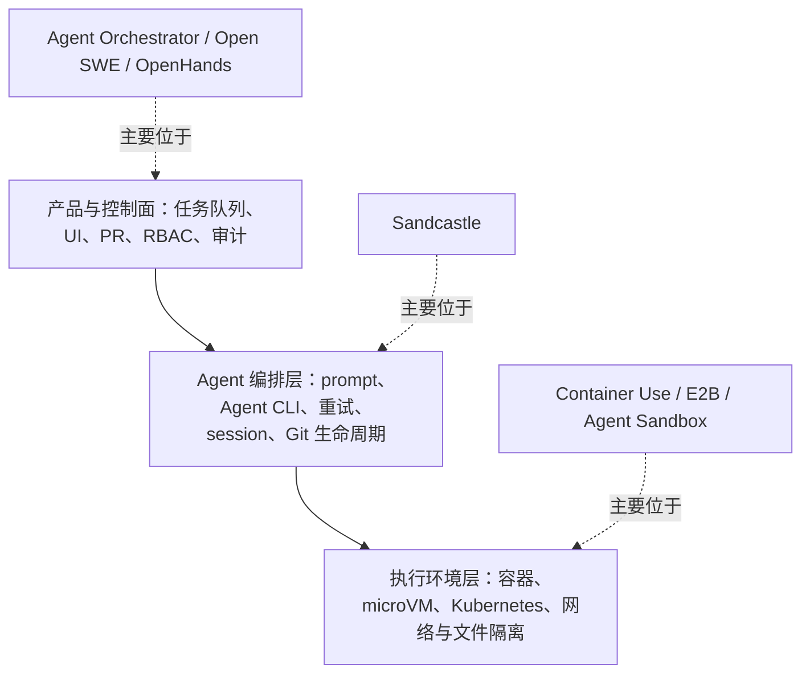
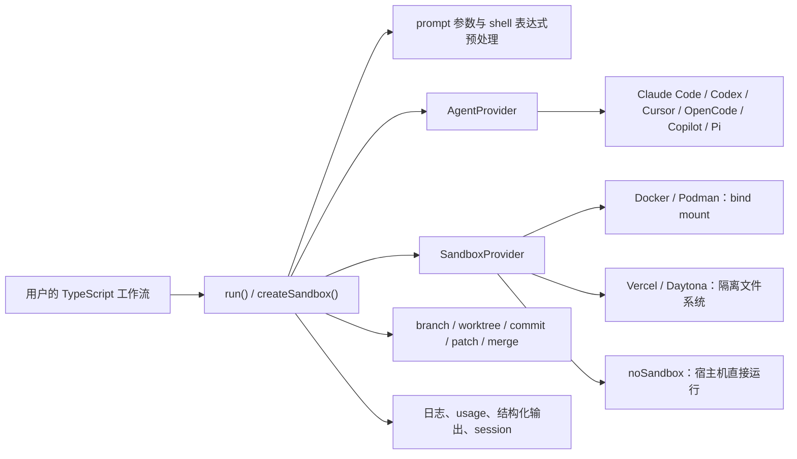
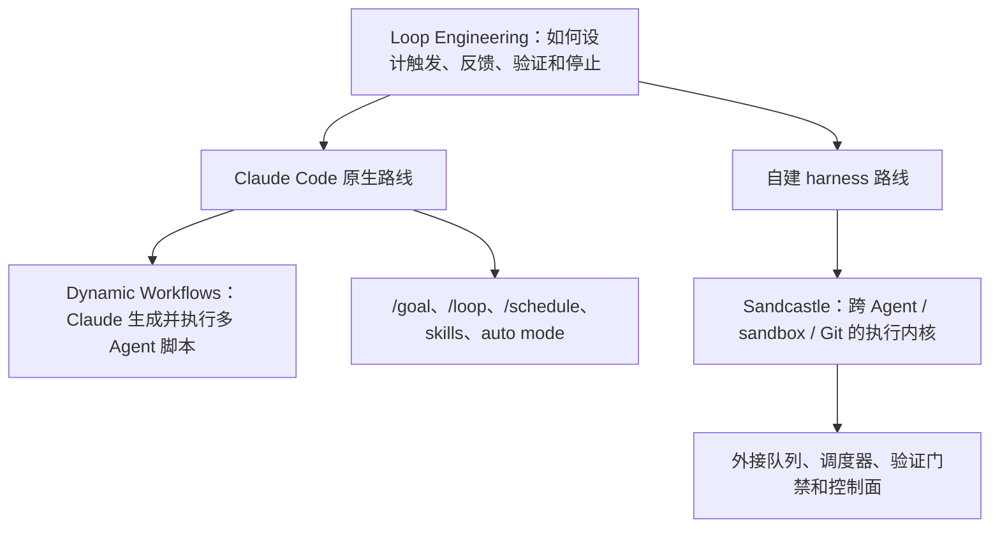

> 研究日期：2026-07-21；Loop Engineering / Dynamic Workflows 补充核验：2026-07-23  
> Sandcastle 基线：[`e99f832`](https://github.com/mattpocock/sandcastle/tree/e99f832f26dc9d245c019a9ddd19fa5dee792427)，npm 版本 `0.12.0`  
> 方法：以源码、官方仓库和官方文档为准；GitHub 热度数据只是当日快照，不作为质量评分。

## 结论先行

[Sandcastle](https://github.com/mattpocock/sandcastle) 不是新的 Coding Agent，也不是单纯的代码沙箱。它是一个 **TypeScript 编排库**：把 Claude Code、Codex、Cursor、OpenCode、Copilot、Pi 等现成 Agent CLI 放进可替换的运行环境，围绕 prompt、Git branch/worktree、提交同步、合并、日志和 Agent session 建立统一生命周期。

它最独特的组合是：

1. **Agent 中立**：复用现成 Agent CLI，而不是重新实现 Agent loop。
2. **Sandbox 中立**：同一工作流可接 Docker、Podman、Vercel Sandbox、Daytona 或自定义 provider。
3. **Git 生命周期是一等能力**：不仅“给 Agent 一个目录”，还处理分支、worktree、commit、patch 和 merge。
4. **工作流即代码**：并行 planner、reviewer、重试、结构化输出都写成普通 TypeScript。
5. **保留原生 Agent session**：部分 Agent 可 capture、resume 和 fork，而不只保存最终 diff。

没有一个著名项目完整覆盖这五点。最接近的开源替代品分别位于不同层：

- **完整编排控制面**：[Agent Orchestrator](https://github.com/AgentWrapper/agent-orchestrator)
- **容器与 Git 环境层**：[Dagger Container Use](https://github.com/dagger/container-use)
- **异步任务到 PR 平台**：[Open SWE](https://github.com/langchain-ai/open-swe)、[OpenHands](https://github.com/OpenHands/OpenHands)
- **本地人工并行管理**：[Claude Squad](https://github.com/smtg-ai/claude-squad)
- **托管商业体验**：Codex cloud、Cursor Cloud Agents、GitHub Copilot cloud agent、Conductor、Devin

因此，Sandcastle 更适合充当 **自建 Coding Agent 平台的编排内核/数据平面**，而不是直接替代一个带账号体系、控制台、队列、审计和 SLA 的 SaaS。

从近期常说的 **Loop Engineering** 和 Claude Code **Dynamic Workflows** 来看，三者确实共享“把 Agent 工作组织成可验证流程”的思想，但不在同一抽象层：Loop Engineering 是方法论，Dynamic Workflows 是 Claude Code 内置的多 Agent 脚本运行时，Sandcastle 则是外置、跨 Agent、跨 sandbox 的可编程执行内核。

## 1. 先把产品放到正确的层

“多 Agent 写代码”相关产品通常横跨三层，很多表面相似的项目其实不能相互替换。



Sandcastle 横跨第二层和第三层的适配接口，但不提供第一层的完整产品能力。E2B、Daytona、Vercel Sandbox 等则主要是它可以调用的底层基础设施，不应被当成一比一竞品。

## 2. Sandcastle 源码拆解

### 2.1 核心调用链



`run()` 是主入口，负责解析 prompt 和环境变量、准备 Git 与 sandbox、循环运行 Agent、收集输出、保存 session，并在结束时同步或合并变更。核心逻辑见 [`src/run.ts`](https://github.com/mattpocock/sandcastle/blob/e99f832f26dc9d245c019a9ddd19fa5dee792427/src/run.ts) 和 [`src/Orchestrator.ts`](https://github.com/mattpocock/sandcastle/blob/e99f832f26dc9d245c019a9ddd19fa5dee792427/src/Orchestrator.ts)。

### 2.2 AgentProvider：适配现成 CLI

内建 provider 包括 Claude Code、Codex、GitHub Copilot、Cursor、OpenCode 和 Pi，导出列表见 [`src/index.ts`](https://github.com/mattpocock/sandcastle/blob/e99f832f26dc9d245c019a9ddd19fa5dee792427/src/index.ts)。统一接口负责：

- 生成非交互 CLI 命令；
- 把 stdout/JSONL 转换成文本、工具调用、usage 和结果事件；
- 声明环境变量与会话存储位置；
- 对支持的 Agent 捕获、恢复或 fork 原生 session。

这是一项真正的差异化：Sandcastle 不要求团队迁移到某个自研 Agent loop，也不把模型选择和运行环境绑在一起。代价是上游 CLI 参数、输出协议和 session 格式变化都会成为兼容性负担，相关适配代码集中在 [`src/AgentProvider.ts`](https://github.com/mattpocock/sandcastle/blob/e99f832f26dc9d245c019a9ddd19fa5dee792427/src/AgentProvider.ts)。

### 2.3 SandboxProvider：统一生命周期，不统一安全强度

[`SandboxProvider`](https://github.com/mattpocock/sandcastle/blob/e99f832f26dc9d245c019a9ddd19fa5dee792427/src/SandboxProvider.ts) 抽象了 `exec`、流式输出、文件复制和 `close` 等能力，并分成三类：

| 类型 | 当前实现 | 代码如何进入环境 | 典型特征 |
|---|---|---|---|
| Bind mount | Docker、Podman | 宿主仓库/worktree 挂载进容器 | 快、Git 状态实时共享；容器能写挂载目录 |
| Isolated filesystem | Vercel、Daytona | copy in，结束后提取 commit/diff/untracked files | 宿主隔离更强；需要可靠同步与冲突处理 |
| No sandbox | `noSandbox()` | 直接使用宿主目录 | 启动最简单，没有 OS 隔离 |

Docker provider 会以匹配宿主 UID/GID 的非 root 用户启动容器，并支持 CPU、mount、device、group、runtime 和 Docker network 配置，见 [`src/sandboxes/docker.ts`](https://github.com/mattpocock/sandcastle/blob/e99f832f26dc9d245c019a9ddd19fa5dee792427/src/sandboxes/docker.ts) 与 [`src/DockerLifecycle.ts`](https://github.com/mattpocock/sandcastle/blob/e99f832f26dc9d245c019a9ddd19fa5dee792427/src/DockerLifecycle.ts)。不过，未显式配置网络时仍使用 Docker 默认网络；公共 provider contract 也没有统一的域名级 egress、secret broker、内存快照或 pause/resume 语义。

Vercel provider 使用 Firecracker microVM，并透传 Vercel 的网络策略；Daytona provider 通过官方 SDK 创建远端环境，当前集成在 `close()` 时删除 sandbox。实现分别见 [`vercel.ts`](https://github.com/mattpocock/sandcastle/blob/e99f832f26dc9d245c019a9ddd19fa5dee792427/src/sandboxes/vercel.ts) 与 [`daytona.ts`](https://github.com/mattpocock/sandcastle/blob/e99f832f26dc9d245c019a9ddd19fa5dee792427/src/sandboxes/daytona.ts)。这意味着 Daytona 自身的持久化、快照和 fork 能力，并不会自动成为 Sandcastle 的统一能力。

### 2.4 Git 是它的核心状态机

Sandcastle 支持三种 branch strategy：

| 策略 | 行为 | 适合场景 | 风险/限制 |
|---|---|---|---|
| `head` | 直接在当前宿主工作目录写入 | 单任务、本地快速运行 | 不是变更隔离；并行任务会互相影响 |
| `merge-to-head` | 创建临时分支/worktree，结束后 merge 回原分支 | 隔离环境中的单任务自动交付 | 会修改宿主分支；冲突仍需处理 |
| `branch` | 在明确命名的分支/worktree 中工作 | 并行任务、人工审核后合并 | 调用方负责分支命名、合并和并发治理 |

一个容易忽略的细节是：`run()` 对 isolated provider 默认使用 `merge-to-head`，但对 bind-mount/no-sandbox provider 默认使用 `head`。换言之，“用了 Docker”不等于“默认获得独立 worktree”；若要安全并行，调用方应显式使用不同分支。默认值见 [`src/run.ts`](https://github.com/mattpocock/sandcastle/blob/e99f832f26dc9d245c019a9ddd19fa5dee792427/src/run.ts)。

隔离文件系统同步回宿主时，Sandcastle 依次处理：

1. 已提交变更：生成 format-patch，再以 `git am --3way` 应用；
2. 未提交变更：生成 diff，再执行 `git apply`；
3. 未跟踪文件：单独复制。

失败时会保留补丁或临时分支，方便恢复，具体逻辑见 [`src/syncOut.ts`](https://github.com/mattpocock/sandcastle/blob/e99f832f26dc9d245c019a9ddd19fa5dee792427/src/syncOut.ts) 和 [`src/SandboxLifecycle.ts`](https://github.com/mattpocock/sandcastle/blob/e99f832f26dc9d245c019a9ddd19fa5dee792427/src/SandboxLifecycle.ts)。这比“任务结束后复制整个目录”更可靠，但复杂 Git 历史、二进制文件和并发合并仍然是应用层需要治理的问题。

### 2.5 并行工作流是模板，不是调度控制面

项目提供 blank、simple loop、sequential reviewer、parallel planner、parallel planner with review 等脚手架。并行模板通常先让 planner 输出任务列表，再用 `Promise.allSettled()` 为每个任务启动一个分支/Agent，最后由 reviewer 或 merge Agent 收口，见 [`parallel-planner/main.mts`](https://github.com/mattpocock/sandcastle/blob/e99f832f26dc9d245c019a9ddd19fa5dee792427/src/templates/parallel-planner/main.mts)。

好处是没有自定义 DSL，复杂业务逻辑可以直接用 TypeScript 表达。边界也很明确：

- 没有内建持久任务队列、worker 池或全局并发上限；
- 没有跨进程的任务状态数据库；
- 没有 backlog、PR、CI、review comment 的持续事件循环；
- 并发数、超时、预算、重试策略和背压由调用方实现。

因此它是 workflow toolkit，不是 fleet scheduler。

### 2.6 Prompt、结构化输出与 session

Prompt 可来自字符串或文件，支持 `{{KEY}}` 参数和在 sandbox 内执行的 `!` shell 表达式；shell 表达式有超时，并行求值。参数替换后新出现的 `!` 不会再次执行，避免把输入参数意外变成命令，见 [`PromptPreprocessor.ts`](https://github.com/mattpocock/sandcastle/blob/e99f832f26dc9d245c019a9ddd19fa5dee792427/src/PromptPreprocessor.ts) 和 [`PromptArgumentSubstitution.ts`](https://github.com/mattpocock/sandcastle/blob/e99f832f26dc9d245c019a9ddd19fa5dee792427/src/PromptArgumentSubstitution.ts)。

[`Output.object`](https://github.com/mattpocock/sandcastle/blob/e99f832f26dc9d245c019a9ddd19fa5dee792427/src/Output.ts) 可用 Standard Schema 校验 Agent 放在 XML tag 中的 JSON，并在失败时自动续接 session 重试。Claude Code、Codex 和 Pi 还支持 session capture/resume/fork。它适合 planner、review verdict、issue extraction 等机器可消费步骤，比仅解析最终自然语言稳定。

### 2.7 可观测性与扩展性

已有能力包括 stdout/file logging、原始行/文本/工具事件回调、token usage、idle timeout、总完成超时，以及失败时保留 worktree/sandbox 现场。扩展 Agent 或 sandbox 也有清晰的 TypeScript contract。

但它没有统一 dashboard、OpenTelemetry trace、组织级审计、租户配额、成本归集或任务检索。Issue tracker 也主要是 `init` 模板里调用 GitHub CLI、Beads 或用户自定义命令，并非核心库中的持久集成，见 [issue tracker 扩展文档](https://github.com/mattpocock/sandcastle/blob/e99f832f26dc9d245c019a9ddd19fa5dee792427/docs/agents/adding-an-issue-tracker.md)。

## 3. 必须单独看的安全边界

Sandcastle 非交互运行 Agent 时，在 Orchestrator 层默认传入 `dangerouslySkipPermissions: true`。各 Agent provider 通常会转换为类似 Claude Code 的 `--dangerously-skip-permissions` 或 Codex 的 `--dangerously-bypass-approvals-and-sandbox`；Claude 的 `permissionMode`、Codex 的 `approvalsReviewer` 可显式改变这一行为。源码证据见 [`Orchestrator.ts`](https://github.com/mattpocock/sandcastle/blob/e99f832f26dc9d245c019a9ddd19fa5dee792427/src/Orchestrator.ts) 和 [`AgentProvider.ts`](https://github.com/mattpocock/sandcastle/blob/e99f832f26dc9d245c019a9ddd19fa5dee792427/src/AgentProvider.ts)。

这是为了让 Agent 无人值守运行，但也意味着 **Agent 自身的确认框不是主要安全边界，sandbox provider 才是**。

| 运行方式 | 文件/进程边界 | 网络默认 | 需要接受的事实 |
|---|---|---|---|
| `noSandbox()` | 无；拥有启动用户的宿主权限 | 宿主网络 | 只能运行高度可信的 prompt、仓库和 hook |
| Docker/Podman bind mount | 容器进程边界；仓库和 Git 元数据是可写挂载 | 通常可出网 | 能保护大部分宿主文件，但不能保护被挂载仓库；共享内核 |
| Vercel Firecracker | 独立 microVM 与文件系统 | 由 provider policy 决定 | 宿主隔离更强，仍需控制 egress、secret 和同步内容 |
| Daytona | 远端隔离环境 | 由 Daytona 配置决定 | 底层能力强，但 Sandcastle contract 未暴露全部治理能力 |

还需注意三点：

1. `hooks.host` 明确在 sandbox 外、以宿主用户权限执行；只应运行仓库内可信命令。
2. [`.sandcastle/.env` 中声明的变量](https://github.com/mattpocock/sandcastle/blob/e99f832f26dc9d245c019a9ddd19fa5dee792427/src/EnvResolver.ts)会注入环境，核心库没有统一 secret broker、短期凭证代理或日志脱敏策略。
3. `merge-to-head` 的最终 Git 操作发生在宿主；sandbox 隔离并不等于交付链路不会修改宿主状态。

若用于组织级无人值守任务，建议至少补上：默认拒绝出网、域名 allowlist、短期凭证、只读基础镜像、资源上限、并发上限、受保护目标分支和必须通过测试/评审的合并门禁。

## 4. 成熟度判断

截至研究日，官方仓库约 6.9k stars、700 forks，MIT 许可；仓库创建于 2026-03，版本为 `0.12.0`。这代表它在很短时间获得了很高关注度，但仍是明显的 pre-1.0 项目。

积极信号：

- 测试覆盖大量 Git、worktree、同步、sandbox、session 和异常路径；
- changelog 显示持续修复 Windows、长输出、worktree、sync 和 session 问题；
- ADR 与内部 provider research 记录了关键架构取舍；
- 接口边界小而清楚，便于自己维护 provider。

风险信号：

- 上游 Agent CLI 变化会直接影响适配层；
- provider 集合和公共 API 仍快速变化；
- 没有长期生产运行、升级兼容和多租户治理的公开证据；
- Git 同步与自动 merge 本身具有大量边界条件。

合理评价是：**设计清晰、早期 traction 很强、适合试点和自建，但不宜仅凭 star 数把它视为成熟平台。**

## 5. 与 Loop Engineering、Dynamic Workflows 的关系

### 5.1 三者相似，但不是同一种东西

“Loop Engineering”目前不是一份有唯一标准定义的规范。Anthropic 也明确提到业界对 loop 有多种说法；Claude Code 团队采用的操作性定义是：**Agent 重复执行工作周期，直到满足停止条件**，并从触发方式、停止方式、使用的运行原语和适用任务来设计 loop。其官方分类包括 turn-based、goal-based、time-based 和 proactive loops，见 [Loop engineering: Getting started with loops](https://claude.com/blog/getting-started-with-loops)。本报告沿用这一较窄、可验证的定义。

| 概念 | 抽象层 | 谁持有控制逻辑 | 核心对象 | 是否绑定 Agent/产品 |
|---|---|---|---|---|
| **Loop Engineering** | 工程方法与系统设计 | Loop 设计者 | trigger、goal、feedback、verification、state、stop condition、人类门禁 | 否 |
| **Claude Code Dynamic Workflows** | Claude Code 内置编排原语与运行时 | Claude 生成的 JavaScript workflow script | 多 Claude subagent 的拆分、并行、交叉验证、汇总与恢复 | 是，绑定 Claude Code runtime |
| **Sandcastle** | 外部 TypeScript harness/执行内核 | 开发者编写的 TypeScript 程序 | Agent CLI、sandbox、Git、session、日志、结构化输出 | Agent 中立，也不绑定单一 sandbox |

可以把关系画成：



所以，**Dynamic Workflows 是实现某些 loop 的产品内原语；Sandcastle 是实现自定义 loop 的外部工具之一；Loop Engineering 则是评价两者是否能稳定收敛的上层方法。** Anthropic 自己给出的 proactive loop 示例也把 `/schedule`、`/goal`、Dynamic Workflows 和 auto mode 组合使用，而不是把 Dynamic Workflows 等同于完整 loop。

### 5.2 Dynamic Workflows 与 Sandcastle 为什么看起来很像

Dynamic Workflows 从 Claude Code `2.1.154` 引入，当前官方文档将其描述为：Claude 根据任务写出 JavaScript 编排脚本，后台 runtime 执行该脚本，子任务结果保存在脚本变量中，最终只把协调后的答案送回会话；脚本可以查看、保存和重跑。发布记录见 [Claude Code CHANGELOG 2.1.154](https://github.com/anthropics/claude-code/blob/main/CHANGELOG.md#21154)，运行语义见 [Dynamic Workflows 官方文档](https://code.claude.com/docs/en/workflows)。它发布时是 research preview；截至补充核验日，官方发布页已更新为 generally available，见 [Introducing dynamic workflows](https://claude.com/blog/introducing-dynamic-workflows-in-claude-code)。

两者共同采用了相似的流程形状：

```text
Planner / Discover
  → 多个独立 Worker 并行执行
  → Reviewer / Verifier 交叉检查
  → 汇总、修正或合并
  → 满足条件后停止
```

Sandcastle 的 [`parallel-planner` 固定版本模板](https://github.com/mattpocock/sandcastle/blob/e99f832f26dc9d245c019a9ddd19fa5dee792427/src/templates/parallel-planner/main.mts#L56-L202)就是 planner 输出结构化任务、`Promise.allSettled()` 并行启动不同分支上的 Agent、最后由 merger 收口；[`sequential-reviewer` 模板](https://github.com/mattpocock/sandcastle/blob/e99f832f26dc9d245c019a9ddd19fa5dee792427/src/templates/sequential-reviewer/main.mts#L50-L117)则表达 implementer → reviewer → 下一轮。因此，从“编排 Agent”这一观察角度说它们相似是准确的。

### 5.3 Sandcastle 对 Loop Engineering 能力的映射

| Loop 要素 | Sandcastle 已提供 | 仍需调用方补齐 |
|---|---|---|
| 任务交接 | `run()`、prompt file/args、可替换 `AgentProvider` | 任务优先级、分派策略和上下文选择 |
| 重复与停止 | `maxIterations`、`completionSignal`、timeout、`AbortSignal`，见 [`RunOptions`](https://github.com/mattpocock/sandcastle/blob/e99f832f26dc9d245c019a9ddd19fa5dee792427/src/run.ts#L345-L426) | 更强的目标 evaluator、无进展检测、全局预算和 durable terminal state |
| 并行分工 | 普通 TypeScript 并发、parallel planner 模板、独立 branch/worktree | worker pool、全局并发上限、背压、优先队列和跨进程恢复 |
| 隔离执行 | Docker、Podman、Vercel、Daytona、自定义 sandbox；三种 Git branch strategy | 统一 egress/secret/资源策略和多租户安全治理 |
| 验证反馈 | sandbox hooks、独立 reviewer Agent、日志/usage；[`Output.object`](https://github.com/mattpocock/sandcastle/blob/e99f832f26dc9d245c019a9ddd19fa5dee792427/src/Output.ts#L54-L108)可做 schema 验证和纠正重试 | 证明与目标代码版本绑定、强制测试门禁、独立可信 evaluator |
| 状态与记忆 | Git commit/branch、日志、部分 Agent 的 session capture/resume/fork | 持久 workflow 状态库、跨进程 checkpoint、业务级 memory |
| 触发与调度 | 可由任意 Node/CI 程序调用 | 核心库没有内建事件总线、定时器、durable queue 或 webhook 控制面 |
| 交付与人工门禁 | patch/commit/merge；失败时保留 worktree/branch | 审批 UI、branch protection、PR/CI/review feedback loop |

这说明 Sandcastle 已覆盖了 loop 中最难重复造的“执行和 Git 交付机械件”，但还没有覆盖完整 Loop Engineering 系统的触发、持久状态、证据门禁和停止治理。

### 5.4 与 Dynamic Workflows 的关键差异和边界

| 维度 | Sandcastle | Claude Code Dynamic Workflows |
|---|---|---|
| 工作流产生方式 | 通常由开发者编写、版本控制的 TypeScript；模板只是起点 | Claude 为当前任务动态生成 JavaScript，也可保存后重跑 |
| Worker 粒度 | 启动独立的完整 Agent CLI 进程，可混用 Claude Code、Codex、Cursor 等 | 一个 Claude Code session 内的 Claude subagent |
| 执行环境 | 每个 run 可显式选择 Docker、Podman、microVM/云 sandbox 或宿主机 | workflow script 在会话外的隔离 runtime 中协调；实际工具调用继承 Claude Code permission 与 sandbox 规则 |
| Git 模型 | branch/worktree/patch/commit/merge 是公共 contract | 可让 Agent 使用隔离副本/worktree，但 Git 交付不是 workflow script 的跨产品抽象 |
| 控制与中间状态 | Node 进程、Git、日志和 Agent session；无内建 workflow dashboard/checkpoint store | `/workflows` 展示阶段、Agent、token 和耗时；可暂停/继续，但恢复限同一 Claude Code session |
| 并发和规模 | 模板直接 `Promise.allSettled()`，核心没有统一限流 | 当前文档上限为同时 16 个 Agent（低资源机器更少）、每次 run 总计 1,000 个 |
| 安全默认值 | AFK 调用在 [`Orchestrator.ts`](https://github.com/mattpocock/sandcastle/blob/e99f832f26dc9d245c019a9ddd19fa5dee792427/src/Orchestrator.ts#L140-L147)默认要求跳过 Agent 权限确认，主要依赖 sandbox；Claude provider 可显式覆盖 permission mode | workflow 启动和子 Agent 工具调用沿用 Claude Code 的 approval、allowlist 与 sandbox 体系；文件编辑由子 Agent 的 `acceptEdits` 模式处理 |
| 可移植性 | 高：Agent 与 sandbox provider 都可替换 | 低：是 Claude Code 产品能力，但使用体验更完整 |

官方宣传会说一次 workflow 可编排数十到数百个 Agent；更精确的理解是：**一次 run 可以累计调度数十到数百个乃至最多 1,000 个 Agent，但当前同时运行上限是 16 个**。这与 Sandcastle 没有内建并发上限形成鲜明对比：前者更有产品化护栏，后者更自由，也更要求调用方治理资源和成本。

还有一个组合边界：Sandcastle 的 Claude provider 会以非交互 print mode 启动 Claude Code，见 [`AgentProvider.ts`](https://github.com/mattpocock/sandcastle/blob/e99f832f26dc9d245c019a9ddd19fa5dee792427/src/AgentProvider.ts#L1181-L1215)。Claude Code 官方文档说明 Dynamic Workflows 可用于 `claude -p` 和 Agent SDK，但 workflow 的调度、权限与恢复仍属于 Claude Code 内部语义，Sandcastle 并没有把它提升为所有 AgentProvider 都具备的公共能力。因此二者可以嵌套使用，却不能据此认为 Sandcastle 原生拥有 Dynamic Workflows 的 dashboard、checkpoint 或规模护栏。

最终判断：

- 想设计“何时触发、如何验证、失败后怎样回路、何时停止”，讨论的是 **Loop Engineering**；
- 想让 Claude 针对一次大任务动态写出并运行多 Agent 脚本，使用 **Dynamic Workflows**；
- 想在自有 TypeScript 系统中跨 Agent、跨 sandbox 地控制 Git 与执行生命周期，使用 **Sandcastle**；
- 想把 Sandcastle 做成完整 loop 平台，还应外接 durable queue/state、scheduler、evidence gate、并发/预算控制和人工审批。

## 6. 开源竞品对比

### 6.1 直接或相邻的开源项目

| 项目 | 定位 | Agent 关系 | 隔离与 Git | 控制面 | 相对 Sandcastle |
|---|---|---|---|---|---|
| **Sandcastle** | TS 编排库 | 包装 6 类现成 CLI | 可插拔 sandbox；branch/worktree/patch/merge 是核心 | 代码、日志；无 dashboard | 最可嵌入、最中立，但平台能力少 |
| [Agent Orchestrator](https://github.com/AgentWrapper/agent-orchestrator) | Agent IDE 与 fleet supervisor | 支持大量终端 Agent | 每 session 一个 Git worktree；本地 daemon/terminal runtime | 桌面端、CLI、PR/CI/review feedback loop | 最接近“完整控制面”；worktree 不是 OS 安全沙箱 |
| [Dagger Container Use](https://github.com/dagger/container-use) | MCP server + CLI 环境层 | 已运行的 Agent 通过 MCP 操作环境 | 每环境一个 OCI 容器和 Git branch；日志、diff、terminal、merge/apply | CLI/MCP，可人工进入 | 最接近环境模型；不负责启动与迭代 Agent |
| [Open SWE](https://github.com/langchain-ai/open-swe) | 异步内部 Coding Agent 应用 | 自有 Deep Agents/LangGraph 工作流 | 每 thread 远端 sandbox，最终 branch/PR | Webhook、dashboard、Slack/Linear/GitHub | issue 到 PR 更完整，但更重、更 opinionated |
| [OpenHands](https://github.com/OpenHands/OpenHands) | 自托管 Agent 平台 | 自有 Agent/SDK，也可接其他 Agent 协议 | Docker/远端 runtime；conversation/workspace 持久化 | Web UI、CLI、REST、Python SDK | 功能和生态更广，Git lifecycle 不如 Sandcastle 统一 |
| [Claude Squad](https://github.com/smtg-ai/claude-squad) | 本地多 Agent TUI | 启动多个 Agent CLI | tmux + Git worktree；没有 OS 隔离 | 终端 TUI、人工 diff/提交 | 更适合人盯着并行会话，不适合编程式无人值守流程 |

热度与许可证快照：Sandcastle 约 6.9k stars/MIT；Agent Orchestrator 约 8.4k/Apache-2.0；Container Use 约 3.9k/Apache-2.0；Open SWE 约 10.4k/MIT；OpenHands 约 81.4k，核心与 Agent Server 为 MIT、企业目录另有许可；Claude Squad 约 8.1k/AGPL-3.0。请以各仓库当前 `LICENSE` 为准。

### 6.2 最接近的三个开源选择

#### Agent Orchestrator：更像上层产品

Agent Orchestrator 把 worktree、终端、会话、PR、CI 失败、review comment 和 merge conflict 放进一个桌面 Agent IDE。官方流程是本地 daemon 为每个 session 创建独立 worktree、启动所选 Agent，并持续把外部反馈路由回对应 session。

它解决的是 Sandcastle 留给调用方的那部分：状态持久化、dashboard、人工接管和 PR feedback loop。反过来，它的“isolated workspace”主要指 Git 工作区隔离；若终端 runtime 直接在本地运行，就不能等同于容器或 microVM 安全边界。需要 **可见的 Agent fleet** 选它，需要 **可嵌入且 sandbox-first 的库** 选 Sandcastle。

#### Dagger Container Use：最相似的环境模型

Container Use 也为每个 Agent 建立独立容器和 Git branch，并提供 `watch`、`log`、`diff`、`terminal`、`merge`、`apply`。它还把命令与环境记录到 Git notes，并提供比 Sandcastle 更完整的 secret 来源与日志遮蔽能力，见 [environment workflow](https://container-use.com/environment-workflow/) 和 [secrets](https://container-use.com/secrets/)。

两者的根本差异是控制方向：

- Sandcastle：宿主 TypeScript 程序启动并监管 Agent CLI；
- Container Use：已经运行的 MCP Agent 主动创建、操作自己的环境。

若想写 planner/reviewer/重试逻辑，Sandcastle 更自然；若想让任何 MCP Agent 自助获得可观察的容器环境，Container Use 更自然。

#### Open SWE / OpenHands：更完整但更重

Open SWE 已把 Slack、Linear、GitHub 触发、远端 sandbox、持久 thread 和 draft PR 串成完整后台应用，具体 provider 可用 Modal、Daytona、Runloop、E2B 或自定义实现，见其 [README](https://github.com/langchain-ai/open-swe) 与 [安装架构](https://github.com/langchain-ai/open-swe/blob/main/INSTALLATION.md)。它非常适合“内部 issue 队列自动变 PR”，但部署依赖和框架约束明显大于 Sandcastle。

OpenHands 则提供 Web UI、CLI、REST Agent Server 和 Python SDK，本地通常用 Docker runtime，也能接远端或 Kubernetes。它适合直接采用一个完整 Agent 平台；Sandcastle 更适合保留 Claude Code/Codex 等官方 CLI 行为，并在自己的程序中精确控制 Git 和流程。

### 6.3 底层基础设施：通常是补充，不是替代

| 项目 | 核心能力 | Sandcastle 没有的强项 | 为什么不是直接竞品 |
|---|---|---|---|
| [E2B](https://github.com/e2b-dev/E2B) | Firecracker microVM sandbox SDK | pause/resume、快照/fork、细粒度网络策略、自托管基础设施 | 不启动 Coding Agent，也不处理 prompt、Git 或 PR |
| [Kubernetes Agent Sandbox](https://github.com/kubernetes-sigs/agent-sandbox) | Kubernetes CRD、WarmPool、持久卷、休眠/恢复 | 集群级调度；可配 gVisor/Kata 与 NetworkPolicy | 是大规模 runtime/control plane，不含 Coding Agent workflow |
| [Daytona](https://github.com/daytonaio/daytona) | 托管 sandbox、快照、网络、审计、SDK | 持久化、快照、规模化和组织治理 | 在 Sandcastle 中已经是 provider；只替换执行层 |

特别注意：Daytona 官方仓库已声明自 **2026-06** 起核心开发迁入私有代码库，公开 AGPL 版本不再更新、修复或发布。因此，历史源码仍可 fork，但当前产品应按“闭源托管服务 + 停止维护的历史开源版本”评估。

## 7. 闭源/商业软件对比

| 产品 | 执行与隔离 | Git/并行体验 | 部署边界 | 相对 Sandcastle |
|---|---|---|---|---|
| [Conductor](https://www.conductor.build/docs/concepts/parallel-agents) | 本地 workspace；worktree 隔离开发状态，不隔离系统权限 | 多 workspace/branch、diff、测试、review、merge，支持多个 Agent | 本地商业桌面软件 | 最像“有 GUI 的本地多 Agent worktree 管理器”；Sandcastle 的真实 sandbox 与自动化 API 更强 |
| [OpenAI Codex cloud](https://developers.openai.com/codex/cloud) | 每任务隔离云环境；Agent 阶段默认断网，可按域名和 HTTP 方法放行 | 并行 cloud tasks、diff/commit/PR、日志证据 | OpenAI 托管；本地 Codex CLI 开源 | 托管安全默认值与产品体验更强，但绑定 Codex/OpenAI 平台 |
| [Cursor Cloud Agents](https://docs.cursor.com/background-agent) | 每 Agent 独立 VM；另有 self-hosted workers | 异步/并行、长期 follow-up、IDE/网页/移动端/API | worker 可在客户网络，推理和编排仍由 Cursor 云承担 | 工作流很接近且 UI 完整；Sandcastle 更透明、完全自管、Agent 中立 |
| [GitHub Copilot cloud agent](https://docs.github.com/en/copilot/concepts/agents/cloud-agent/about-cloud-agent) | GitHub Actions 临时环境，也可用 self-hosted runner；带 Agent firewall | issue → branch → PR，自动化、审计、组织策略完善 | GitHub 托管控制面 | GitHub-native 和企业治理最强；Sandcastle 更适合非 GitHub/定制流程 |
| [Cognition Devin](https://docs.devin.ai/enterprise/deployment/overview) | 每 session 隔离 Linux VM；Dedicated 是 Cognition 管理的单租户 VPC | backlog、浏览器任务、并行 Devin、Coordinator、PR | “brain” 始终在 Cognition cloud | 更像完整 AI 软件工程师；可控性、中立性和自托管弱于 Sandcastle |
| [Google Jules](https://jules.google/docs/environment/) | 每任务短生命周期 Ubuntu VM，可联网 | 异步任务、日志、plan approval、GitHub PR | Google 托管，API 仍为 `v1alpha` | 上手门槛低；定制编排、部署和企业治理选择较少 |

### 商业产品带来的真正差异

这些产品的优势通常不在“能不能启动一个 Agent”，而在 Sandcastle 没有提供的运营面：

- 账号、SSO、RBAC、仓库授权和组织策略；
- 持久任务队列、状态恢复、通知、移动端和人工接管；
- GitHub App、issue/PR/CI/review 的持续闭环；
- secret 生命周期、网络防火墙、审计日志与合规；
- 用量计费、预算、并发配额、SLA 和托管镜像维护。

Sandcastle 的反向优势是没有产品锁定：团队可以选择任意 Agent、模型、sandbox、issue tracker 和 Git 策略，把控制数据留在自己的基础设施中。

## 8. 横向能力矩阵

以下是基于公开能力的定性比较，不是综合排名。`强` 表示产品核心能力，`中` 表示可配置或部分覆盖，`弱` 表示需要用户自行实现或不是产品重点。

| 方案 | 可嵌入编程 | Agent 中立 | Sandbox 中立 | Git 生命周期 | Fleet/PR 控制面 | 默认安全治理 | 自管执行/部署 |
|---|---:|---:|---:|---:|---:|---:|---:|
| Sandcastle | 强 | 强 | 强 | 强 | 弱 | 弱 | 强 |
| Agent Orchestrator | 中 | 强 | 弱 | 强 | 强 | 弱 | 强 |
| Container Use | 中 | 强 | 弱 | 强 | 中 | 中 | 强 |
| Open SWE | 中 | 中 | 强 | 强 | 强 | 中 | 中 |
| OpenHands | 强 | 中 | 中 | 中 | 强 | 中 | 强 |
| Conductor | 弱 | 强 | 弱 | 强 | 强 | 弱 | 本地运行 |
| Codex cloud | 中 | 弱 | 弱 | 强 | 强 | 强 | 弱 |
| Cursor Cloud Agents | 中 | 中 | 中 | 强 | 强 | 强 | 中 |
| GitHub Copilot cloud agent | 中 | 中 | 中 | 强 | 强 | 强 | 中 |
| Devin | 中 | 弱 | 弱 | 强 | 强 | 强 | 弱 |

这里最值得强调的是：`worktree` 只隔离文件状态和 Git 变更，不等于 OS 权限隔离；“本地运行”也不等于“完全自托管控制面”。比较安全性时必须看进程、文件、网络、凭证和控制数据分别在哪里。

## 9. 按场景选择

| 需求 | 优先考虑 | 原因 |
|---|---|---|
| 在内部工具或 CI 中写自定义多 Agent 流程 | **Sandcastle** | TypeScript API 小、Agent/Sandbox 可替换、Git handoff 明确 |
| 同时管理很多终端 Agent，并自动接住 CI/review/冲突 | **Agent Orchestrator** | 已有 dashboard、session 和 PR feedback loop |
| 让任何 MCP Agent 自己创建可观察的容器环境 | **Dagger Container Use** | MCP/CLI、Git notes、terminal/diff/merge 体验完整 |
| 自托管一个带 UI/API 的完整 Coding Agent 平台 | **OpenHands** | 产品面最完整、生态和成熟度更高 |
| Slack/Linear/GitHub issue 自动变 draft PR | **Open SWE** | 端到端事件流已内建 |
| 人在本地 GUI 中监督多个 Claude/Codex/Cursor | **Conductor** 或 **Agent Orchestrator** | worktree、终端、diff 和人工接管更直观 |
| 希望最少运维且要较强默认网络限制 | **Codex cloud** | Agent 阶段默认断网并支持 allowlist |
| 深度依赖 Cursor IDE，同时要云端/私网 worker | **Cursor Cloud Agents** | IDE、移动端、API 与 self-hosted worker 组合 |
| GitHub 企业治理、审计和 issue→PR 是第一优先级 | **GitHub Copilot cloud agent** | 与 GitHub 权限、Actions、PR 和组织策略原生结合 |
| 建设共享的高密度 sandbox 基础设施 | **E2B** 或 **Kubernetes Agent Sandbox** | 快照、恢复、调度、网络与多租户能力更接近平台层需求 |

## 10. 对 Sandcastle 的最终评价

### 它做得最好的地方

- 模块边界简单：Agent、sandbox、Git 和 workflow 没有被揉成一个巨型框架；
- 能复用用户已经信任和付费的 Agent CLI；
- Git handoff 设计比多数“给 Agent 一台机器”的 SDK 更完整；
- TypeScript 工作流比 YAML/专用 DSL 更灵活；
- 既能本地运行，也能逐步把高风险任务迁到 microVM/远端 provider。

### 它的主要短板

- “sandbox”不是统一安全等级，默认 bind-mount/head 很容易被误读为强隔离；
- 无人值守默认跳过 Agent 权限确认，安全策略必须由部署者补齐；
- 并行只是模板级 `Promise.allSettled()`，没有队列、限流、租户和资源调度；
- 没有 durable control plane、dashboard、PR/CI 事件循环和团队治理；
- secret、egress、审计和合并门禁没有形成跨 provider 的统一 contract；
- 项目年轻且 pre-1.0，需要为 API 与上游 CLI 变化预留维护预算。

### 如果要基于它做内部平台

建议保留 Sandcastle 作为执行内核，不要重复实现 AgentProvider/Git 同步；在上层补：

1. 持久任务队列、幂等状态机和最大并发；
2. GitHub/GitLab App、PR/CI/review feedback loop；
3. 默认拒绝出网、域名 allowlist 和短期凭证代理；
4. 容器内存/PID/CPU 限制与 microVM 高风险任务池；
5. OpenTelemetry、审计事件、成本与 token 预算；
6. 合并前测试、review 与 branch protection gate；
7. 管理员策略：禁止 `noSandbox()`、禁止不可信 host hook、限制可用镜像/provider。

## 11. 一句话判断

**Sandcastle 的价值不是“又一个 AI 编程产品”，而是把现成 Agent CLI、可替换 sandbox 与 Git 交付生命周期连接成一个小而可编程的内核。**

如果你要造自己的平台，它比完整 Agent 平台更合适；如果你只想马上管理团队、PR 和大量后台任务，Agent Orchestrator、OpenHands/Open SWE 或成熟商业产品会更省事；如果你只缺安全执行环境，直接采用 E2B、Daytona 或 Kubernetes Agent Sandbox 更合理。

## 主要一手资料

- Sandcastle：[仓库与 README](https://github.com/mattpocock/sandcastle)、[固定版本源码](https://github.com/mattpocock/sandcastle/tree/e99f832f26dc9d245c019a9ddd19fa5dee792427)、[CHANGELOG](https://github.com/mattpocock/sandcastle/blob/e99f832f26dc9d245c019a9ddd19fa5dee792427/CHANGELOG.md)
- Loop Engineering / Dynamic Workflows：[Claude Code 团队的 Loop Engineering 定义与分类](https://claude.com/blog/getting-started-with-loops)、[Dynamic Workflows 文档](https://code.claude.com/docs/en/workflows)、[发布与 GA 更新](https://claude.com/blog/introducing-dynamic-workflows-in-claude-code)、[Claude Code CHANGELOG](https://github.com/anthropics/claude-code/blob/main/CHANGELOG.md)
- Agent Orchestrator：[官方仓库](https://github.com/AgentWrapper/agent-orchestrator)
- Dagger Container Use：[官方仓库](https://github.com/dagger/container-use)、[工作流](https://container-use.com/environment-workflow/)、[Secrets](https://container-use.com/secrets/)
- OpenHands：[官方仓库](https://github.com/OpenHands/OpenHands)、[Docker sandbox](https://docs.openhands.dev/openhands/usage/sandboxes/docker)、[架构](https://docs.openhands.dev/openhands/usage/architecture/runtime)
- Open SWE：[官方仓库](https://github.com/langchain-ai/open-swe)、[安装架构](https://github.com/langchain-ai/open-swe/blob/main/INSTALLATION.md)
- Claude Squad：[官方仓库](https://github.com/smtg-ai/claude-squad)
- E2B：[官方仓库](https://github.com/e2b-dev/E2B)、[持久化](https://e2b.dev/docs/sandbox/persistence)、[Snapshots](https://e2b.dev/docs/sandbox/snapshots)
- Kubernetes Agent Sandbox：[官方仓库](https://github.com/kubernetes-sigs/agent-sandbox)、[文档](https://agent-sandbox.sigs.k8s.io/docs/)
- Daytona：[官方仓库及停止维护声明](https://github.com/daytonaio/daytona)、[持久化文档](https://www.daytona.io/docs/en/persistence/)
- Conductor：[Parallel agents](https://www.conductor.build/docs/concepts/parallel-agents)、[Workflow](https://www.conductor.build/docs/concepts/workflow)、[Security and permissions](https://www.conductor.build/docs/reference/security-and-permissions)
- OpenAI Codex：[Cloud](https://developers.openai.com/codex/cloud)、[环境](https://developers.openai.com/codex/cloud/environments)、[联网控制](https://developers.openai.com/codex/cloud/internet-access)
- Cursor：[Background Agents](https://docs.cursor.com/background-agent)、[Self-hosted Cloud Agents](https://cursor.com/blog/self-hosted-cloud-agents)、[SDK/API](https://cursor.com/changelog/sdk-release)
- GitHub Copilot：[Cloud agent](https://docs.github.com/en/copilot/concepts/agents/cloud-agent/about-cloud-agent)、[环境](https://docs.github.com/en/copilot/how-tos/copilot-on-github/customize-copilot/customize-cloud-agent/customize-the-agent-environment)、[Firewall](https://docs.github.com/en/copilot/how-tos/copilot-on-github/customize-copilot/customize-cloud-agent/customize-the-agent-firewall)
- Devin：[部署边界](https://docs.devin.ai/enterprise/deployment/overview)、[环境](https://docs.devin.ai/onboard-devin/environment)、[API](https://docs.devin.ai/api-reference/overview)
- Google Jules：[环境](https://jules.google/docs/environment/)、[API](https://jules.google/docs/api/reference/)
